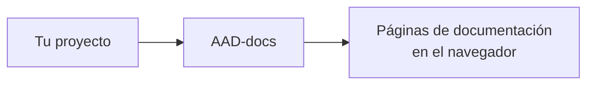

# AAD-docs

Lee esta página para saber qué es AAD-docs y cómo se usa.

AAD-docs muestra la documentación de un proyecto en el navegador. Cada parte del proyecto trae su propia documentación, y AAD-docs la reúne en un solo lugar con un menú para recorrerla. Las páginas podrán incluir tablas, capturas de pantalla, avisos destacados, pasos y pestañas.

**Estado: en diseño.** El diseño está escrito, pero todavía no se puede usar. Este repositorio contiene el plan, la documentación del proyecto y unas herramientas que la revisan.

## Cómo se usa

1. Abre la dirección `/docs/` del proyecto en tu navegador.
2. Elige una sección en el menú.
3. Cambia el idioma con el selector si la página existe en español.

## Qué leer después

- Qué hace y qué no hace: [aad_docs/docs/01-overview.es.md](aad_docs/docs/01-overview.es.md)
- Cómo recorrer la documentación: [aad_docs/docs/05-guides/browse-the-docs.es.md](aad_docs/docs/05-guides/browse-the-docs.es.md)

La documentación técnica está solo en inglés: [README.md](README.md).
