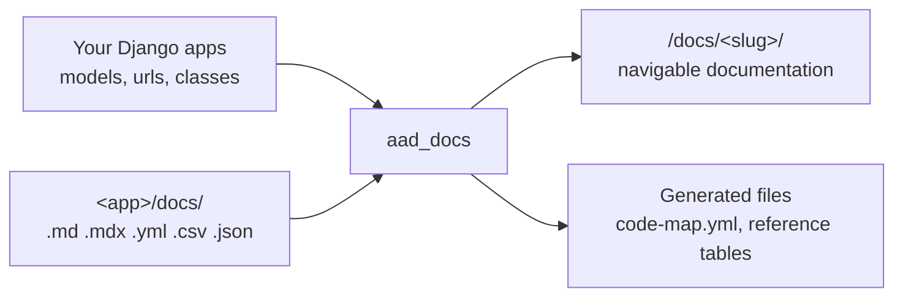

# AAD-docs

Read this page to learn what AAD-docs is and where to go next. It takes five minutes.

AAD-docs is an installable Django app. It finds the `docs/` folder inside each of your Django apps and serves it as navigable documentation at `/docs/`. The documentation is flat files that live next to the code they describe.

**Status: planning.** No code exists yet. This repository holds the project plan and the technical documentation, written in the standard the app will enforce. The documentation of AAD-docs is the project's own example.

## Where to go

| You want to | Read |
|---|---|
| Find any document | [docs/00-map.md](docs/00-map.md) |
| See what gets built and in what order | [docs/PLAN.md](docs/PLAN.md) |
| Understand what the app does and does not do | [aad_docs/docs/01-overview.md](aad_docs/docs/01-overview.md) |
| Install it in a project | [docs/02-getting-started.md](docs/02-getting-started.md) |
| See how it is built | [docs/03-architecture.md](docs/03-architecture.md) |
| Learn the documentation standard | [docs/HOW-DOCS-WORK.md](docs/HOW-DOCS-WORK.md) |

Versión en español: [README.es.md](README.es.md)
