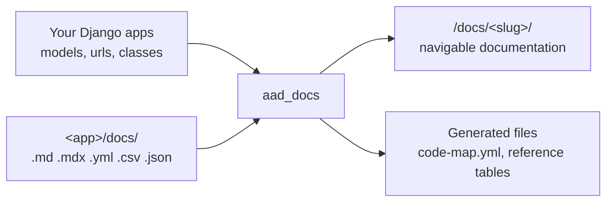

# AAD-docs

Read this page to learn what AAD-docs is and where to go next. It takes five minutes.



AAD-docs is an installable Django app. It finds the `docs/` folder inside each of your Django apps and serves it as navigable documentation at `/docs/`. The documentation is flat files that live next to the code they describe. English is the default language and other languages are added page by page; this repository adds Spanish for people who use the system. Pages can embed tables, flows, screenshots and visual components such as callouts, steps, tabs and cards.

**Status: design phase.** The design is written and no package code exists yet. This repository holds the plan, the technical documentation, written in the standard the app will enforce, and a few tools that check it. The documentation of AAD-docs is the project's own example. The next step is milestone M1a, the installable package and a demo project: see the [roadmap](docs/PLAN.md#roadmap).

## Where to go

| You want to | Read |
|---|---|
| Find any document | [docs/00-map.md](docs/00-map.md) |
| See what gets built and in what order | [docs/PLAN.md](docs/PLAN.md) |
| Understand what the app does and does not do | [aad_docs/docs/01-overview.md](aad_docs/docs/01-overview.md) |
| Install it in a project | [docs/02-getting-started.md](docs/02-getting-started.md) |
| See how it is built | [docs/03-architecture.md](docs/03-architecture.md) |
| Learn the documentation standard | [docs/HOW-DOCS-WORK.md](docs/HOW-DOCS-WORK.md) |
| Put a table, a flow or a callout inside a page | [aad_docs/docs/05-guides/embed-a-piece.mdx](aad_docs/docs/05-guides/embed-a-piece.mdx) |
| Know why it is built this way, and which decisions still wait for the owner | [aad_docs/docs/07-decisions/](aad_docs/docs/07-decisions/) and [Open decisions](docs/PLAN.md#open-decisions) |
| Work on this repository, as a person or as a coding agent | [AGENTS.md](AGENTS.md) |

## Work on this repository

```bash
tools/setup.sh   # once: installs the dependencies
tools/check.sh   # before every commit: links, CSV, JSON, YAML and Mermaid diagrams
```

The requirements are listed in [docs/08-operations.md](docs/08-operations.md#agent-tooling). Agents also have two skills, in `.claude/skills/`, that publish the repository documentation as one navigable page where the owner can approve pending decisions.

Versión en español: [README.es.md](README.es.md)
