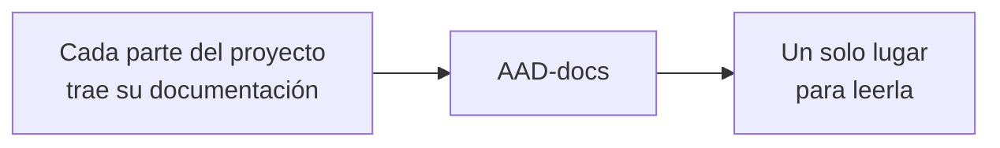

# Qué es AAD-docs

Lee esta página para saber para qué sirve AAD-docs, cuándo usarlo y qué no hace.

## Qué es

AAD-docs reúne la documentación de un proyecto y la muestra en el navegador.

- Cada parte del proyecto guarda su propia documentación.
- Un menú te deja ir de una parte a otra.
- Algunas páginas son interactivas: tablas que puedes ordenar y filtrar, y procesos que puedes recorrer paso a paso.
- Las páginas pensadas para quien usa el sistema están en español.

## Cuándo usarlo

- Quieres saber cómo se hace una tarea en el sistema.
- Quieres entender qué hace una parte del proyecto.

## Qué no hace

- No permite cambiar la documentación desde el navegador.
- No es un sitio público: solo entra el personal autorizado.

## Qué leer después

- Cómo recorrer la documentación: [browse-the-docs.es.md](05-guides/browse-the-docs.es.md)
