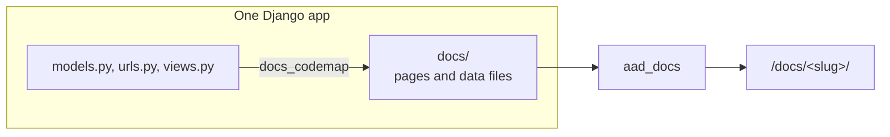

# Overview

Read this page to know what AAD-docs is for, when to use it and what it does not do.



## What it is

AAD-docs is a Django app that turns the `docs/` folder of each installed app into navigable documentation.

- Documentation lives inside the app it describes. Move or delete the app and its documentation goes with it.
- Everything is a flat file: `.md`, `.yml`, `.csv` or `.json`. It reads in full on GitHub or in an editor with nothing installed.
- The parts of the documentation that the code already knows are generated from the code: models, fields, relations, routes, classes.
- The app adds what flat files cannot: a menu, a language switch and interactive views of the data files.

## When to use it

- A project has grown past what its owner can hold in memory.
- You come back to a project after months and need to find where things are.
- A non-technical user needs to know how to use the system, in Spanish.

## What it does not do

- It does not edit documentation in the browser.
- It does not store anything in a database. The app has no models.
- It does not write your pages. Commands only write generated files.
- It does not publish a public site.

## How it works in one example

An app called `orders` gets a folder `orders/docs/` with an `__init__.py` and a page.

```
orders/
├── models.py
└── docs/
    ├── __init__.py        ← resolves the node: slug, title, order, pages
    ├── 01-overview.md     ← written by a person
    └── code-map.yml       ← generated from the code
```

The node appears at `/docs/orders/`. Its model documentation is whatever `Order` declares in its `Meta`, its fields and its docstring.

## Next

- Install it: [02-getting-started.md](../../docs/02-getting-started.md)
- Document an app: [document-an-app.md](05-guides/document-an-app.md)
- Why it is built this way: [07-decisions/](07-decisions/)
