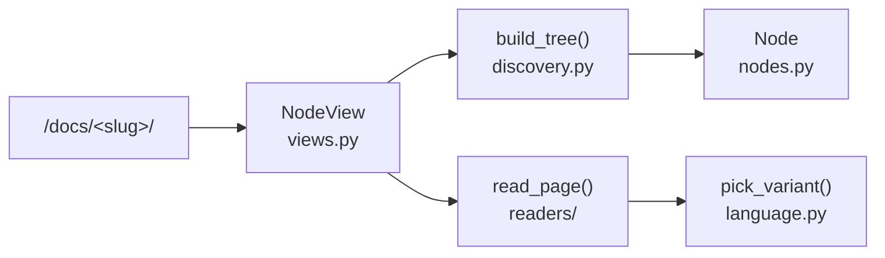

# Read the code

Use this page to decide where to start reading the code of `aad_docs`.

**Status: design target.** The code does not exist yet. The modules, classes and routes are listed in [code-map.yml](code-map.yml), which `docs_codemap` regenerates from milestone 2 on. This page holds only what the code cannot say: where to start.

## Start here

| If you want to | Start in |
|---|---|
| Understand how a `docs/` folder becomes a node | `discovery.py`, then `nodes.py` |
| Change what a node can declare | `nodes.py` |
| Change a setting or its default | `conf.py` |
| Change what an address resolves to, or how a path is kept inside its folder | `routing.py` |
| Add or change how a file type is read | `readers/` |
| Change which language a page shows in | `language.py` |
| Change what the browser receives | `views.py` and `templates/aad_docs/` |
| Change what `docs_codemap` extracts | `codemap/` |
| Add a rule to `docs_check` | `checks.py` |
| Change how hand edits to generated files are detected | `generated.py` |
| Change an interactive view | `static/aad_docs/` |

## Reading order

1. `nodes.py`: the two objects everything else passes around.
2. `discovery.py`: how the tree is built.
3. `views.py`: the contract with the frontend.
4. `readers/`: one small module per file type.

## Next

- Every module, class and route: [code-map.yml](code-map.yml)
- One request, step by step: [request-flow.json](request-flow.json)
- Components and contract: [03-architecture.md](../../docs/03-architecture.md)
