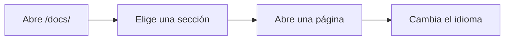

# Recorrer la documentación

Sigue esta guía para encontrar una página de la documentación de un proyecto y leerla en tu idioma.

**Estado: en planificación.** Todavía no hay pantallas. Las capturas de cada paso se agregarán cuando exista la interfaz.

## Antes de empezar

- La dirección del proyecto.
- Una cuenta de usuario con acceso de personal.

## Pasos

1. Abre `/docs/` en la dirección del proyecto e inicia sesión.
2. Elige una sección en el menú de la izquierda. Cada sección es una parte del proyecto.
3. Abre una página. Están en el orden en que conviene leerlas.
4. En una tabla, haz clic en el título de una columna para ordenarla y escribe en el cuadro de filtro para ver menos filas.
5. En un proceso, pulsa Siguiente para avanzar un paso a la vez.
6. Cambia el idioma con el selector de arriba. Si una página no existe en español, se muestra en inglés.

## Resultado

Estás leyendo la página que buscabas, y el menú te muestra en qué parte del proyecto está.

## Qué hacer después

- Si `/docs/` no te deja entrar, pide acceso de personal a quien administra el proyecto.
