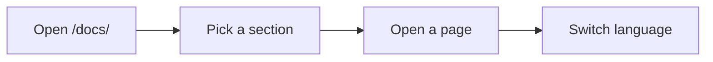

# Browse the docs

Follow this guide to find a page in the documentation of a project and read it in your language.

**Status: planned.** The interface arrives at milestone 1 of the [plan](../../../docs/PLAN.md). Screenshots are taken by `docs_screenshots` at milestone 4.

## Before you start

- The address of the project.
- A user account with staff access.

## Steps

1. Open `/docs/` on the project's address and sign in.
2. Pick a section in the menu on the left. Each section is one part of the project.
3. Open a page. Pages are listed in reading order.
4. On a table, click a column title to sort and type in the filter box to narrow the rows.
5. On a flow, press Next to move one step at a time.
6. Switch the language with the selector at the top. A page without a Spanish version stays in English.

## Result

You are reading the page you looked for, and the menu shows where it sits in the project.

## Next

- What each kind of page is for: [HOW-DOCS-WORK.md](../../../docs/HOW-DOCS-WORK.md)
- If `/docs/` denies access, ask the project owner for staff access.
