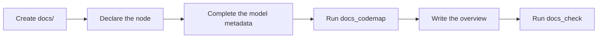

# Document an app

Follow this guide to give one of your Django apps its documentation node, with a generated code map.



**Status: planned.** Steps 1, 2 and 5 work from milestone 1; steps 3, 4 and 6 from milestones 2 and 4. See the [plan](../../../docs/PLAN.md).

## Before you start

- AAD-docs installed: [02-getting-started.md](../../../docs/02-getting-started.md)
- The page anatomy and the tone rules: [HOW-DOCS-WORK.md](../../../docs/HOW-DOCS-WORK.md)

The examples use an app called `orders`.

## Steps

1. Create the folder.

   ```bash
   mkdir -p orders/docs
   ```

2. Declare the node in `orders/docs/__init__.py`. Every option is listed in [node-options.csv](../06-reference/node-options.csv).

   ```python
   from aad_docs import Node

   node = Node(
       slug="orders",
       title="Orders",
       title_es="Pedidos",
       order=20,
       pages=["01-overview", "04-code-map", "code-map"],
   )
   ```

3. Complete the metadata of your models. This is the model documentation; nothing else is written for it.

   ```python
   class Order(models.Model):
       """A customer's order."""

       status = models.CharField(
           max_length=20,
           choices=Status.choices,
           help_text=_("Where the order is in its lifecycle."),
       )

       class Meta:
           verbose_name = _("order")
           verbose_name_plural = _("orders")
   ```

4. Generate the code map and the reference tables.

   ```bash
   python manage.py docs_codemap orders
   ```

5. Write `orders/docs/01-overview.md`: what the app is for, when to use it, what it does not do. Do not list fields or routes; they are already in the generated files.

6. Check the result.

   ```bash
   python manage.py docs_check orders
   ```

## Result

`/docs/orders/` shows the overview, and the code map opens as an explorer where each model, route and class names its file. `docs_check` reports nothing.

## Next

- Add a guide for a task: create `orders/docs/05-guides/` with an `__init__.py`.
- Add a Spanish page for non-technical users: `01-overview.es.md` next to `01-overview.md`.
- If `docs_check` reports a finding, look it up in [checks.csv](../06-reference/checks.csv).
