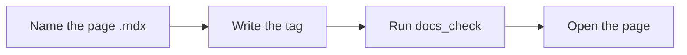

# Embed a piece in a page

Follow this guide to place a table, a flow or a model inside a page, next to the text that explains it.



**Status: planned.** The reader arrives at milestone 3. See the [plan](../../../docs/PLAN.md).

## Before you start

- A page in your app node: [document-an-app.md](document-an-app.md)
- The data the piece reads: a `.csv`, a `.json` of type flow, or a model of your app.

## Steps

1. Rename the page from `.md` to `.mdx`. Do not keep both files.

   ```bash
   git mv orders/docs/01-overview.md orders/docs/01-overview.mdx
   ```

2. Write the tag where the piece belongs. Each tag and its attributes are in [mdx-tags.csv](../06-reference/mdx-tags.csv).

   ```mdx
   An order moves through these states:

   <Flow src="order-states.json" />

   Fields of an order:

   <Model name="orders.Order" />
   ```

3. Check the page.

   ```bash
   python manage.py docs_check orders
   ```

## Result

The page shows the flow and the field table in place. `docs_check` reports no unknown tag, no missing `src` and no import.

## Next

- Why the tags are a closed list: [0011 · `.mdx` is Markdown with a closed set of tags](../07-decisions/0011-mdx-closed-tag-set.md)
- If `docs_check` reports a finding: [checks.csv](../06-reference/checks.csv)
