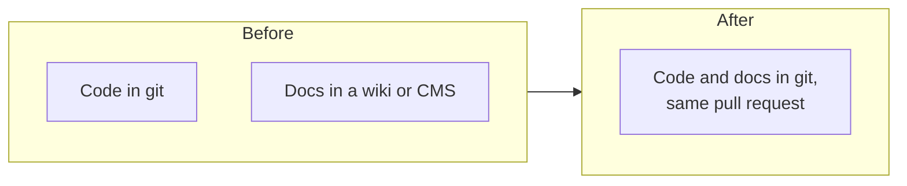

# 0001 · Documentation is flat files

Read this page to know why the documentation is stored as files and not in a database or an external tool.

**Status:** Accepted · 2026-11-14

## Context

Documentation kept outside the repository falls behind the code, has its own history and needs its own access.

## Decision

All documentation is `.md`, `.mdx`, `.yml`, `.csv` or `.json` in the repository. The app has no models and stores nothing.

## Alternatives

- A wiki or CMS: editable in the browser, but separate from the code and its review.
- A database inside the app: adds migrations and a second source of truth.

## Consequences

- Git history is the documentation history.
- Everything reads on GitHub or in an editor without the app.
- No editing in the browser.
- Interactive views must be drawn from data files, not written as custom pages.

## Next

- [0002 · Documentation lives inside each app](0002-docs-inside-each-app.md)
- Narrowed by [0009 · An optional database index](0009-optional-database-index.md)
