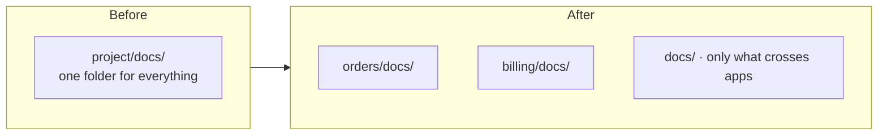

# 0002 · Documentation lives inside each app

Read this page to know why each Django app carries its own `docs/` folder.

**Status:** Accepted · 2026-11-14

## Context

One central folder grows without structure, and nothing ties a page to the code it describes.

## Decision

Django reads `./<app>/docs/<file-name>`. The app finds that folder in every installed app, the way Django finds `templates/` and `static/`. A root `docs/` holds only what crosses apps: map, getting started, architecture, operations.

## Alternatives

- One central `docs/` folder: simpler to find, but detached from the code.

## Consequences

- Moving or deleting an app moves or deletes its documentation.
- A reusable app ships with its documentation, if `docs/` is declared as package data.
- The root node is a proposal added to the original design; it can be turned off with the `ROOT` setting.

## Next

- [0003 · `__init__.py` resolves the node](0003-init-resolves-the-node.md)
