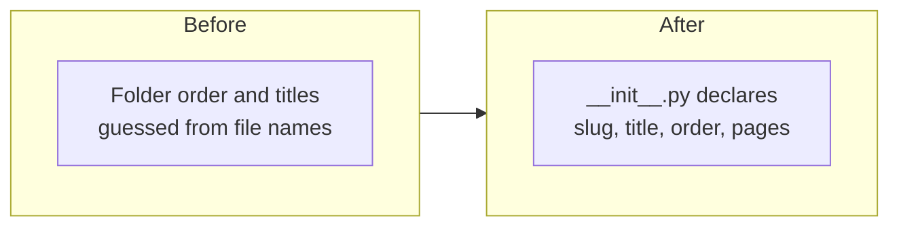

# 0003 · `__init__.py` resolves the node

Read this page to know why a documentation folder is declared with a Python file.

**Status:** Accepted · 2026-11-14

## Context

A node needs a slug, a title in each language, an order and a page list. Something has to declare them, and a folder has to opt in to being a node.

## Decision

Each documentation folder has an `__init__.py` that exposes `node`. A folder without it is not a node. An empty file is valid and takes every default. The slug sets the address `/docs/<slug>/` and does not have to match the app name.

## Alternatives

- A `_node.yml` file: declarative and safe to read, but it cannot decide anything at request time.
- File-name conventions only: no place for titles in two languages or for hiding a page.

## Consequences

- The node can decide: hide a page by permission, build children on the fly.
- Importing the file runs code. A node that fails to import is skipped and reported, never fatal.
- The folder becomes a Python package, so it follows Python naming for imports.

## Next

- Every option: [node-options.csv](../06-reference/node-options.csv)
- [0004 · English is the source](0004-english-source-spanish-for-users.md)
