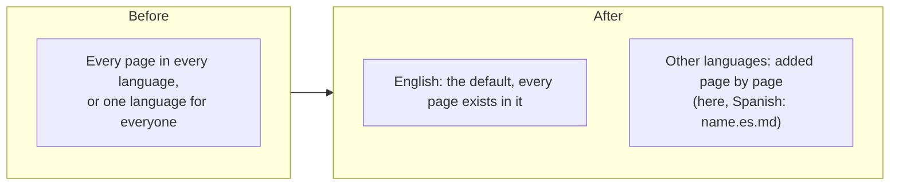

# 0004 · English is the default language; other languages are added per page

Read this page to know which language a page is written in by default, how another language is added, and what this project does with Spanish.

**Status:** Accepted · 2026-11-14. Reworded 2026-11-15 to state the rule for any language; the choice of Spanish is this project's example.

## Context

Technical readers work in English, and a project needs one language in which every page exists. Other readers, such as the people who use the system, need some pages in their own language, and that set of languages differs from one project to another.

## Decision

English is the default language: the first of `LANGUAGES`, the source of every page and the fallback when a page has no variant for the active language. Any other language can be added, one page at a time, as a variant file `name.<language>.md` next to `name.md` (`name.<language>.mdx` for an `.mdx`).

This repository adds Spanish as its example. Spanish covers the short README, the overview and the guides a non-technical user performs. The remaining pages stay in English only.

## Alternatives

- Translate everything into every language: multiplies the work, and the translations fall behind.
- A separate folder for each language, such as `es/`: splits one page into two places.
- Make the default language a setting with no rule: the source of a page would change from project to project.

## Consequences

- Adding a language is adding files and the language code to `LANGUAGES`. No code changes.
- A translated page is written for its reader, not translated word by word: for the Spanish pages, no jargon, no commands and a screenshot on each step.
- Each variant records its source and sync date so `docs_check` can report it as stale.
- A page without a variant falls back to English.
- Model texts come from Django translations, not from `docs/`.

## Next

- [0005 · Model metadata is the model documentation](0005-model-metadata-is-the-documentation.md)
