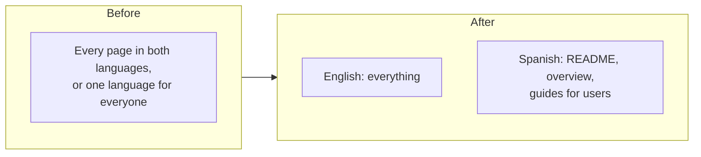

# 0004 · English is the source, Spanish is for non-technical users

Read this page to know which documents exist in each language and why.

**Status:** Accepted · 2026-11-14

## Context

Technical readers work in English. The people who use the systems read Spanish and do not need architecture or reference pages.

## Decision

English is the main language and the only one for technical documents. Spanish covers the short README, the overview and the guides a non-technical user performs. A Spanish page is `name.es.md` next to `name.md`.

## Alternatives

- Translate everything: doubles the work and the Spanish falls behind.
- A separate `es/` folder: splits one page into two places.

## Consequences

- A Spanish page is not a literal translation: no jargon, no commands, a screenshot on each step.
- Each Spanish page records its source and sync date so `docs_check` can report it as stale.
- A page without a Spanish version falls back to English.
- Model texts come from Django translations, not from `docs/`.

## Next

- [0005 · Model metadata is the model documentation](0005-model-metadata-is-the-documentation.md)
