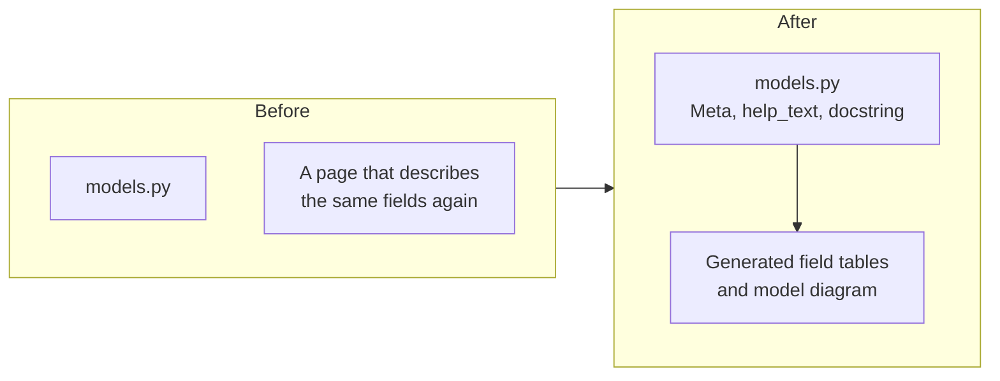

# 0005 · Model metadata is the model documentation

Read this page to know why models are documented in the model and nowhere else.

**Status:** Accepted · 2026-11-14

## Context

A model already declares its name, fields, types, choices and relations. A page that repeats them is out of date at the next migration.

## Decision

The metadata of a model resolves its documentation. `docs_codemap` reads it and generates the model section of `code-map.yml`, the field tables and the model diagram.

| Metadata | Declared in | Becomes |
|---|---|---|
| `verbose_name`, `verbose_name_plural` | `class Meta` | Readable name of the model |
| Docstring | The class | What the model represents |
| `verbose_name`, `help_text` | Each field | Field table with its explanation |
| Type, `null`, `blank`, `default`, `choices` | Each field | Type, whether it is required, allowed values |
| `ForeignKey`, `ManyToManyField`, `related_name` | Each field | Relations and the model diagram |
| `ordering`, `constraints`, `permissions` | `class Meta` | Rules and permissions |
| `app_label` | `_meta` | The node the model belongs to |

Only standard Django metadata is used. Django rejects unknown options in `class Meta`.

## Alternatives

- A hand-written model page: readable, but a copy.
- A custom attribute on the model that points to a document: needs a workaround in `Meta` and still splits the source.

## Consequences

- To fix the documentation of a model, edit the model.
- A model without a docstring or a field without `help_text` is reported as undocumented.
- Spanish comes from `gettext_lazy` and the project's translations.
- `aad_docs` has no models, so this feature is shown and tested in the demo app.

## Next

- [0006 · One owner per fact](0006-one-owner-per-fact.md)
