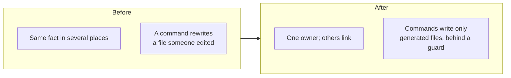

# 0006 · One owner per fact; generated and hand-written never share a file

Read this page to know how the documentation avoids repeating itself and overwriting a person's work.

**Status:** Accepted · 2026-11-14. The manifest mechanism is proposed.

## Context

Generating documentation from code creates two dangers: the same fact written by hand and by a command, and a command that overwrites what a person wrote.

## Decision

- Each fact has one owner. The table is in [HOW-DOCS-WORK.md](../../../docs/HOW-DOCS-WORK.md).
- A file is generated or hand-written, never both. Commands never write a `.md`.
- A command that finds a generated file edited by hand stops and reports it.
- If a `.md` and the model disagree, the model wins.

Proposed mechanism: each `docs/` folder holds a `.generated.yml` manifest with the hash of every generated file. A hash that no longer matches means a hand edit. A manifest is used instead of a header inside each file because `.csv` and `.png` cannot carry one cleanly; `code-map.yml` also carries a comment that says it is generated.

## Alternatives

- Markers inside a `.md` that a command fills in: mixes both kinds in one file.
- A header in every generated file: breaks `.csv` rendering on GitHub and is impossible for images.

## Consequences

- A `.md` that needs to show a model references it, and the app inserts it when drawing the page.
- `docs_check` reports copies: a `.md` that repeats a `help_text` or holds a hand-made field table.
- Deleting a generated file is always safe; the next run recreates it.

## Next

- [0007 · The frontend is Django templates](0007-frontend-django-templates.md)
