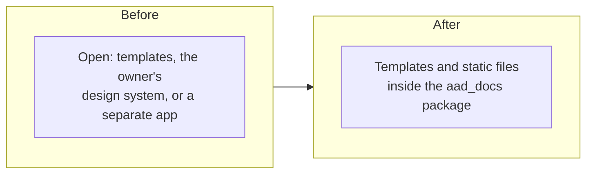

# 0007 · The frontend is Django templates and plain JavaScript

Read this page to know how the browser side is built and what is still open.

**Status:** Proposed · 2026-11-14. Not confirmed by the project owner.

## Context

The app must install with one line in `INSTALLED_APPS`. The interactive pieces are small: a menu, a click-through explorer, a sortable table, a step simulator.

## Decision

The frontend is Django templates plus plain JavaScript and one stylesheet, shipped in the package. Mermaid is vendored as a static file. No build step.

The boundary stays the same whatever the frontend is: views pass the node tree and the page content, and the frontend never opens a file.

## Alternatives

- Build on the owner's own design system: consistent with his other projects, but adds a dependency to every install.
- A separate single-page app: richer, but needs a build and an API.

## Consequences

- Nothing to build or deploy besides the package.
- Templates can be overridden per project, the Django way.
- Changing this decision later replaces templates and static files only.

## Next

- [0008 · Package name and dependencies](0008-package-name-and-dependencies.md)
