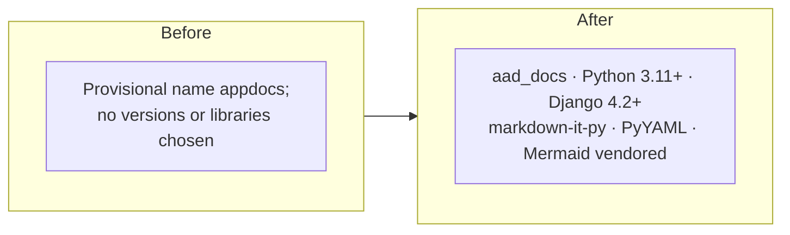

# 0008 · Package name, versions and dependencies

Read this page to know what the package is called, what it requires and who can read the documentation by default.

**Status:** Proposed · 2026-11-14. Not confirmed by the project owner.

## Context

The design used `appdocs` as a provisional name. The repository is `AAD-docs`. The package needs a name, a supported range and the fewest dependencies that do the job.

## Decision

| Item | Proposed |
|---|---|
| Import name | `aad_docs` |
| Setting | `AAD_DOCS`, a dictionary |
| URL namespace | `aad_docs` |
| Python | 3.11 or later |
| Django | 4.2 or later |
| Markdown | `markdown-it-py` |
| YAML | `PyYAML` |
| CSV, JSON | Standard library |
| Mermaid | Vendored static file, runs in the browser |
| Default access | Staff users only |

## Alternatives

- Keep `appdocs`: generic, and it does not match the repository.
- Render Mermaid on the server: needs Node or a headless browser on every install.
- Open access by default: the documentation lists models and routes.

## Consequences

- Two runtime dependencies.
- Diagrams need JavaScript in the browser; on GitHub they render without the app.
- Projects that want open documentation set `ACCESS`.

## Next

- Every setting: [settings.csv](../06-reference/settings.csv)
- What gets built: [PLAN.md](../../../docs/PLAN.md)
- [0009 · An optional database index](0009-optional-database-index.md)
