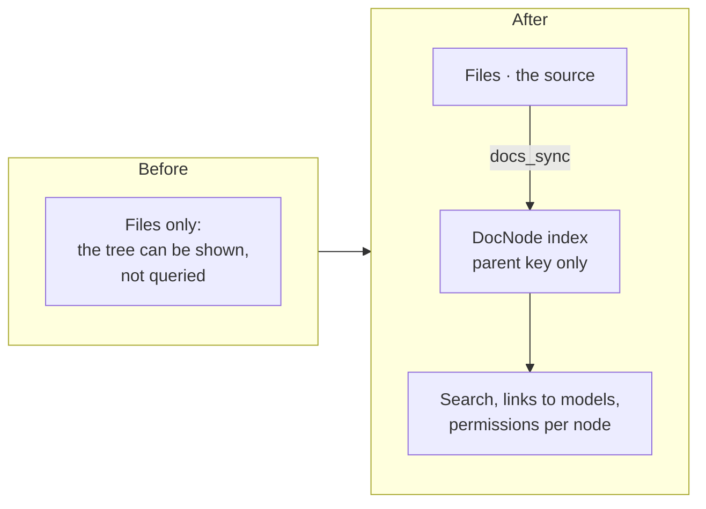

# 0009 · An optional database index with django-tree-queries

Read this page to know why a later delivery adds a database index of the documentation, and why the files stay the source.

**Status:** Recommended for a future delivery · 2026-11-15. Not scheduled before milestone 6 of the [plan](../../../docs/PLAN.md).

## Context

The node tree is built in memory from the `docs/` folders. That is enough to show it: menu, breadcrumbs and pages need no database. It is not enough to query it. Search across all pages, links between a page and a model, and permissions managed in the admin need rows.

## Decision

Add an optional module, `aad_docs.index`, that mirrors the node tree in one model built on [django-tree-queries](https://github.com/feincms/django-tree-queries).

- The files stay the only source. The index is derived and can be deleted and rebuilt at any time.
- A command, `docs_sync`, rebuilds it from the files.
- The core works without the module. A project that does not install it has no model and no migration from AAD-docs.

This narrows [decision 0001](0001-flat-files.md): the documentation is still flat files, and the app still stores nothing that is not in them or derived from them.

## What it adds

| Gain | What it enables |
|---|---|
| Search | Title and text of every page indexed; each result shows its path in the tree |
| Links to real objects | A node points to a model; the admin of that model links to its page, and the page links back |
| Permissions per node | A group assigned to a node applies to everything under it, set in the admin |
| Queries over a branch | "Every stale Spanish page under Orders" is one query; `docs_check` findings are stored and browsable |
| State a file cannot hold | When a page was synced, how often it is read, whether it helped |

It does not make navigation faster. With hundreds of nodes the in-memory tree is already immediate.

## Alternatives

- **No index.** Keeps the app without models. Search would have to scan files on every request, and the other gains are not possible.
- **django-mptt.** Stores `lft`, `rght`, `level` and `tree_id` on every row. Reads are fast, but each insert or move rewrites many rows and the tree can be left inconsistent, which is the wrong trade for an index that is rebuilt from files. Its README states the project is unmaintained and recommends django-tree-queries.
- **django-tree-queries.** Stores only the `parent` key and computes the tree at query time with a recursive query. Rebuilding is deleting and recreating rows; there are no computed columns to corrupt. Chosen.

## Consequences

- With the module installed, the project gets one model and its migrations.
- The index can fall behind the files. `docs_sync --check` in CI reports it, the same way `docs_codemap --check` does for generated files.
- The module needs PostgreSQL, SQLite 3.8.3+, MySQL 8.0+ or MariaDB 10.2.2+, and integer or UUID primary keys. On MySQL and MariaDB a tree can be at most 50 levels deep.
- django-tree-queries becomes a dependency of the optional module only.

## Next

- When it is built: [PLAN.md](../../../docs/PLAN.md)
- The decision it narrows: [0001 · Documentation is flat files](0001-flat-files.md)
- [0010 · Addresses come from metadata](0010-addresses-from-metadata.md)
