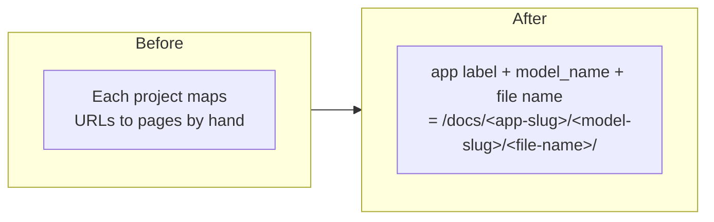

# 0010 · Addresses come from metadata

Read this page to know why the address of a page is fixed by the app and the model, and what that rules out.

**Status:** Proposed · 2026-11-15. Not confirmed by the project owner.

## Context

The documentation is served on the live site. Code, templates and the admin need to link to the page of an app or a model. If every project chose its own paths, each link would be written by hand and would break when a page moved.

## Decision

The address is derived from metadata that already exists. No setting maps a page to a path.

| Part | Comes from | Example |
|---|---|---|
| `<app-slug>` | The app `label`, underscores turned into hyphens; `slug` in the node overrides it | `orders` |
| `<model-slug>` | The `model_name` of the model | `order` |
| `<file-name>` | The file name without numeric prefix, language suffix or extension | `lifecycle` |

- `/docs/<app-slug>/<model-slug>/` is the page of a model, generated from its metadata. It needs no file.
- A folder named after the model slug holds hand-written pages about that model. It is the one folder that needs no `__init__.py`.
- The language is not part of the address.
- `docs_url()` returns the address of an app, a model or a page, so no code writes a path.
- The project chooses only the `/docs/` prefix, where it mounts the URLs.
- A section and a model that produce the same slug collide: the section answers and the model page is out of reach until one is renamed.
- Two files of one folder that produce the same slug collide too, whatever their type. A data file is addressed by its stem like a page.

## Alternatives

- **Paths declared in each node.** Flexible, and every link depends on a value somebody can mistype.
- **Language in the address (`/en/…`, `/es/…`).** Each page would have two addresses to keep. One address that shows the active language is enough.
- **Numeric ids.** Stable, and unreadable in a link or a bookmark.

## Consequences

- Renaming an app or a model changes its address. Linking through `docs_url()` keeps links correct.
- A collision is reported as D007 (section and model) or D008 (two files). Nothing resolves it silently.
- The model slug cannot be overridden, so a link to a model never depends on a second source of truth.

## Next

- The scheme in full: [03-architecture.md](../../../docs/03-architecture.md#addresses)
- The check that reports collisions: [checks.csv](../06-reference/checks.csv)
- [0011 · `.mdx` is Markdown with a closed set of tags](0011-mdx-closed-tag-set.md)
