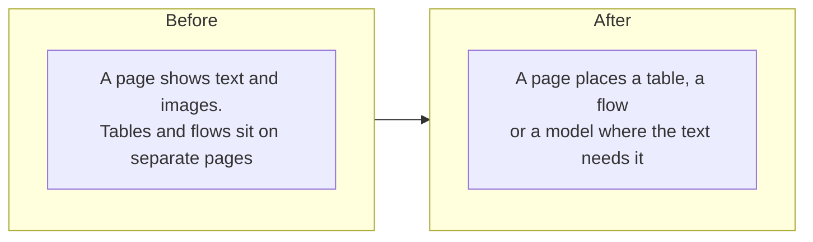

# 0011 · `.mdx` is Markdown with a closed set of tags

Read this page to know what an `.mdx` file may contain and why it cannot hold code.



**Status:** Proposed · 2026-11-15. Not confirmed by the project owner.

## Context

A reader should see the table, the flow or the model next to the sentence that explains it. In `.md` the piece lives on another page and the text only links to it. The owner asked for `.mdx` support.

## Decision

An `.mdx` file is Markdown plus a closed list of tags. The reader replaces each tag with its piece. Every tag is listed in [mdx-tags.csv](../06-reference/mdx-tags.csv).

```mdx
Orders move through these states:

<Flow src="order-states.json" />

<Table src="06-reference/order-fields.csv" />
```

- Only the listed tags exist. An unknown tag is an error, reported as D060.
- A tag points to data (`src`, `name`) and holds no logic.
- No `import`, no `export` and no JavaScript expressions. `docs_check` reports them as D062.
- Nothing is compiled. The reader is Python and the browser mounts the piece, as for any other page.
- A page is either `.md` or `.mdx`, never both with the same name (D008).
- A Spanish page is `name.es.mdx`.

## Alternatives

- **Full MDX.** Any React component, any expression. It needs Node and a build in every project, and a page can run arbitrary code.
- **`.md` with links.** No new reader, and the piece stays apart from the text that explains it.
- **Embedding by convention in `.md`** (a special code fence). Works, and the page loses the standard Markdown that GitHub shows correctly.

## Consequences

- No build step; a project installs the package and nothing else.
- Authors cannot create a new piece inside a page. A new piece is a change to the package, with a new tag in the list.
- GitHub is expected to show an `.mdx` file as text, with the tags visible. This has not been verified. Pages that must read well on GitHub stay `.md`.

## Next

- Use it: [embed-a-piece.mdx](../05-guides/embed-a-piece.mdx)
- The tags: [mdx-tags.csv](../06-reference/mdx-tags.csv)
- Where the reader sits: [03-architecture.md](../../../docs/03-architecture.md)
