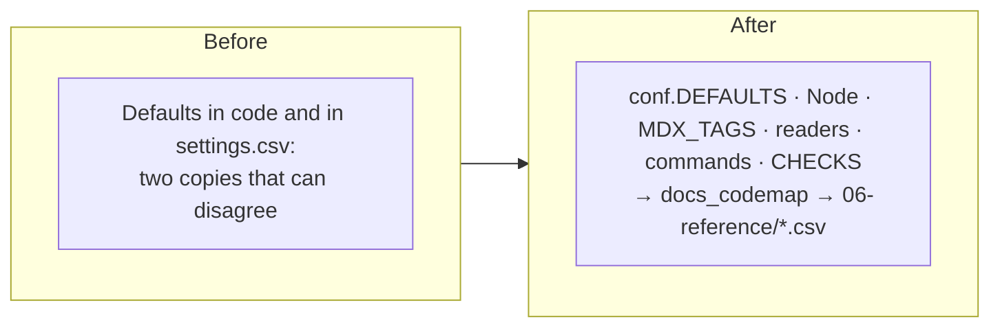

# 0012 · Reference tables are generated from their owner in code

Read this page to know where each table in `06-reference/` gets its values, and why none is written by hand once its owner exists.

**Status:** Proposed · 2026-11-15. Not confirmed by the project owner.

## Context

`settings.csv`, `node-options.csv`, `mdx-tags.csv`, `file-types.csv`, `commands.csv` and `checks.csv` describe things the code already defines. Written by hand they repeat it, and the standard forbids that: [decision 0006](0006-one-owner-per-fact.md).

## Decision

Each table has one owner in Python. `docs_codemap` generates the table from it, and the table is never edited.

| Table | Owner |
|---|---|
| `settings.csv` | `conf.DEFAULTS` |
| `node-options.csv` | The fields of `nodes.Node` |
| `mdx-tags.csv` | `readers.mdx.MDX_TAGS` |
| `file-types.csv` | The registry of readers in `readers/__init__.py` |
| `commands.csv` | The `docs_*` management commands |
| `checks.csv` | `checks.CHECKS`, added at M4 |

- The code never reads a table to get its values. The direction is always code, then table.
- A column that code cannot introspect, such as `writes`, `shown_as` or `places_in_the_page`, is declared as an attribute next to its owner.
- `milestone` is a fact of the plan, not of the code. It stays in the tables while they are design targets and is removed when each one is delivered.
- Until its generator exists, a table is written by hand as a design target. The first run replaces it once and records its hash; after that a hand edit stops the command (D040).

## Alternatives

- **Read the CSV at runtime.** One copy, but the code would depend on a documentation file.
- **Keep both and test that they match.** Two sources and a test to keep them equal.

## Consequences

- A change to a default, a tag or a rule reaches the documentation with `docs_codemap` and is caught in CI by `docs_codemap --check`.
- Owners carry some prose, such as the meaning of a setting. That text lives in one place: the code.

## Next

- How generated files are protected: [03-architecture.md](../../../docs/03-architecture.md#generated-files)
- The tables: [06-reference/](../06-reference/)
