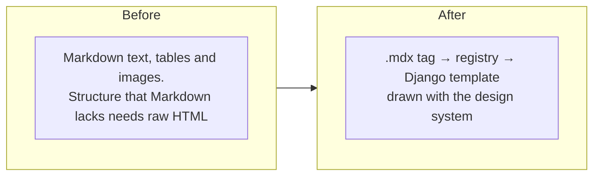

# 0013 · Pages use visual components from a closed registry

Read this page to know how a page gets callouts, steps, tabs and cards, and why an author cannot write HTML or define a component of their own.



**Status:** Proposed · 2026-11-15. Not confirmed by the project owner.

## Context

Markdown has headings, lists, tables and code. A documentation page also needs a warning that stands out, a procedure drawn as steps, alternatives in tabs and a set of linked cards. The owner asked for documentation elements that become visual components, as in his other projects: `wagtail-shopify` reads components that stand alone on a line, and `django-dsadmin` ships its components as Django templates.

## Decision

Every visual element is a component in one registry, `readers.mdx.MDX_TAGS`. The registry is the owner of [mdx-tags.csv](../06-reference/mdx-tags.csv).

A component has:

| Part | Meaning |
|---|---|
| Name | The tag an author writes: `Callout`, `Steps`, `Tabs` |
| Form | `line` for a tag on one line; `container` for a tag that opens and closes on its own lines and holds Markdown |
| Attributes | Each with a type, whether it is required and, where it applies, the list of values |
| Parent | The container it may sit in: `Tab` only in `Tabs`, `Card` only in `Cards` |
| Template | `aad_docs/templates/aad_docs/components/<name>.html` |

The first set:

| Component | Shows |
|---|---|
| `Callout` | A note, tip, warning or danger box around the text it holds |
| `Steps` | A numbered list drawn as a sequence |
| `Tabs` and `Tab` | Alternatives, one panel for each tab |
| `Cards` and `Card` | A grid of linked cards |
| `Details` | A section the reader opens and closes |
| `Model`, `ModelDiagram`, `Table`, `Explorer`, `Flow`, `Screenshot` | The data pieces of [decision 0011](0011-mdx-closed-tag-set.md) |

```mdx
<Callout type="warning">
Run `docs_codemap --check` before you merge.
</Callout>
```

- The reader renders the body of a container as Markdown, then renders the template with its attributes and body.
- Templates use the classes of the design system chosen in [0007](0007-frontend-django-templates.md) and no inline style.
- No component needs JavaScript except `Tabs`. Without it, every panel shows in order.
- Text attributes, such as `title` and `summary`, are translated in the `.es.mdx` file.
- An author cannot define a component in a page. A new component is a registry entry, a template and a test, and `mdx-tags.csv` is regenerated from it.

## Alternatives

- **Raw HTML in the page.** No registry to maintain, but `docs_check` cannot validate it and a public site would run its scripts.
- **Components defined in each page, as in full MDX.** It needs a build and lets a page run code: [0011](0011-mdx-closed-tag-set.md).
- **GitHub alert syntax only** (`> [!NOTE]`). It works in `.md` and on GitHub, and covers callouts only.

## Consequences

- GitHub shows the tags of an `.mdx` as text. A page that must read well there stays `.md`.
- A component is a contract: its attributes and template are part of the interface, and renaming one is a breaking change.
- `docs_check` reports an unclosed container or a tag in the wrong parent (D063) and a missing or unlisted attribute (D064).
- The appearance of every page changes in one place, the templates.

## Next

- The tags and their attributes: [mdx-tags.csv](../06-reference/mdx-tags.csv)
- Use them: [embed-a-piece.mdx](../05-guides/embed-a-piece.mdx)
- The frontend decision: [0007 · The frontend is Django templates and plain JavaScript](0007-frontend-django-templates.md)
