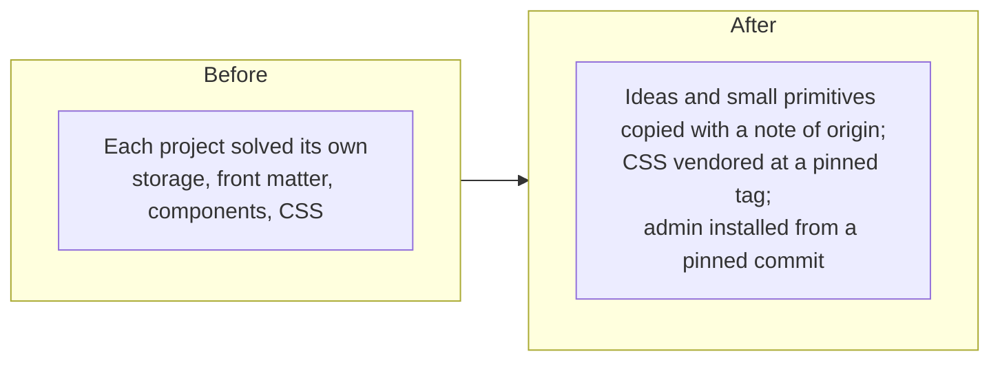

# 0014 · What AAD-docs takes from the owner's other repositories

Read this page to know which logic and modules of the owner's other projects AAD-docs reuses, how it reuses each one, and which it rejects.

**Status:** Accepted · 2026-11-17. Confirmed by the project owner when requesting the `plt-design-system` and `django-dsadmin` integrations.

## Context

The owner asked that AAD-docs reuse logic and modules already built in his projects. A review of his repositories found code that solves the same problems, and code that would tie every install to a project that has its own life. Reused source is therefore copied, vendored or pinned to an exact commit rather than following a moving branch.

`plt-design-system` is chosen for two reasons. First, its shared contract works across Django templates and the owner's other working environments without making AAD-docs depend on any one frontend stack. Second, its tokens and themes keep the structure stable while allowing each environment to change its visual style. AAD-docs uses the `docs-light` theme, but keeps its own CSS limited to documentation layout and behavior.

## Decision

Each source is reused in one of four ways.

| Way | Meaning |
|---|---|
| **Copy** | A small, stable piece is rewritten or copied into `aad_docs`, with the repository and commit it came from in a comment. No link remains. |
| **Vendor** | A built file is stored in the package at a pinned version, with its license beside it, as Mermaid is. |
| **Reference** | The repository is a model to read. No code moves. |
| **Depend** | A maintained package is installed from an exact commit because keeping its fixes and compatibility is safer than forking it. |

| Source | What AAD-docs takes | Way |
|---|---|---|
| `django-md-cms` | Front-matter parsing, content hashing and the storage layout of Markdown files | Reference, then rewrite. Its writing path is not reused: the manifest of [0012](0012-reference-tables-from-their-owner.md) owns what may be overwritten |
| `wagtail-shopify` (`content_store`) | The idea of reading a component that stands alone on a line | Rewrite as the `line` form of the registry in [0013](0013-visual-components.md) |
| `django-dsadmin` | The admin presentation layer, the settings pattern and the Playwright screenshot loop | Install commit `4798410` for the admin; copy and adapt the two small patterns for `conf.py` and `docs_screenshots` |
| `plt-design-system` | The compiled `docs-light` CSS and daisyUI/PLT class contract used by the templates | Vendor package version 0.7.0 at commit `975f7a8`. The package ships the built file and provenance, not the sources or build toolchain |
| `kv` | The first real project to document | Candidate for M5; not chosen |
| `vibeblocks`, `b-style` | Nothing | Rejected as dependencies: each brings its own model of the page |
| Third-party MIT forks (`django-admin-mcp-api`, `django-admin-rest-api`) | Nothing | Out of scope for a documentation app |

The admin integration adds `django-dsadmin` as a pinned runtime dependency ([0008](0008-package-name-and-dependencies.md)). The documentation frontend still ships its own templates and compiled `docs-light` theme.

## Alternatives

- **Depend on `django-md-cms`.** It would save the storage code, but it brings a content model and a database, and the core has none through M5.
- **Copy the admin templates.** This would fork the admin presentation code and lose fixes from `django-dsadmin`; the pinned dependency keeps one owner for that code.
- **Depend on `plt-design-system` from its repository.** Every install would need access to a private source and a Tailwind/daisyUI build. Vendoring the built file avoids both while preserving the same HTML class contract across environments.
- **Keep a parallel AAD-docs visual system.** It permits local styling, but duplicates tokens and primitives and drifts from the owner's other environments. A small consumer stylesheet on top of the shared theme provides the required flexibility without a fork.
- **Reuse nothing.** It repeats solved problems and breaks the owner's request.

## Consequences

- A fix in a source repository does not reach `aad_docs` by itself. A copy has its origin in a comment so that someone can compare.
- The demo replaces Django's standard admin app with `dsadmin.apps.AdminConfig`. Existing `admin.site` registrations keep working, and the admin uses a compiled PLT theme without adding a frontend build step.
- `docs_screenshots` uses Playwright only through the optional `screenshots` extra. It captures the running project's real HTML and fails instead of writing placeholder images when the browser or page is unavailable.
- The vendored CSS has a pinned package version, commit, checksum and update note in `08-operations.md`. Its provenance file records that the upstream pin has no standalone license file; the compiled Tailwind notice remains embedded.
- Templates use daisyUI primitives with the `d-` prefix and PLT `theme-*` treatments. `plt-*` remains only for AAD-docs compositions and behavior hooks.
- `docs.css` may arrange documentation-specific layout, but it does not redefine the design-system tokens or primitive components.
- `docs_check` does not look at the source repositories.

## Next

- The frontend decision: [0007 · The frontend is Django templates and plain JavaScript](0007-frontend-django-templates.md)
- Package and dependencies: [0008](0008-package-name-and-dependencies.md)
- What gets built: [PLAN.md](../../../docs/PLAN.md)
