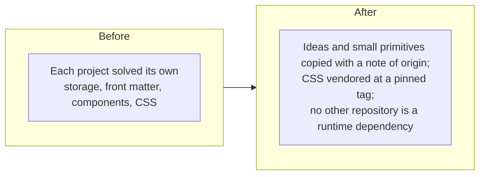

# 0014 · What AAD-docs takes from the owner's other repositories

Read this page to know which logic and modules of the owner's other projects AAD-docs reuses, how it reuses each one, and which it rejects.

**Status:** Proposed · 2026-11-15. Not confirmed by the project owner.

## Context

The owner asked that AAD-docs reuse logic and modules already built in his projects. A review of his repositories found code that solves the same problems, and code that would tie every install to a project that has its own life. An installed package must not break because another repository changed.

## Decision

Each source is reused in one of three ways.

| Way | Meaning |
|---|---|
| **Copy** | A small, stable piece is rewritten or copied into `aad_docs`, with the repository and commit it came from in a comment. No link remains. |
| **Vendor** | A built file is stored in the package at a pinned version, with its license beside it, as Mermaid is. |
| **Reference** | The repository is a model to read. No code moves. |

| Source | What AAD-docs takes | Way |
|---|---|---|
| `django-md-cms` | Front-matter parsing, content hashing and the storage layout of Markdown files | Reference, then rewrite. Its writing path is not reused: the manifest of [0012](0012-reference-tables-from-their-owner.md) owns what may be overwritten |
| `wagtail-shopify` (`content_store`) | The idea of reading a component that stands alone on a line | Rewrite as the `line` form of the registry in [0013](0013-visual-components.md) |
| `django-dsadmin` | The pattern of a settings dictionary merged over defaults, and the script that takes screenshots of every screen | Copy the pattern for `conf.py` and `docs_screenshots` |
| `plt-design-system` | The compiled CSS the templates use | Vendor at a pinned tag. The package ships the built file, not the sources |
| `kv` | The first real project to document | Candidate for M5; not chosen |
| `vibeblocks`, `b-style` | Nothing | Rejected as dependencies: each brings its own model of the page |
| Third-party MIT forks (`django-admin-mcp-api`, `django-admin-rest-api`) | Nothing | Out of scope for a documentation app |

The runtime dependencies stay `markdown-it-py` and `PyYAML` ([0008](0008-package-name-and-dependencies.md)). A reuse never adds one.

## Alternatives

- **Depend on `django-md-cms`.** It would save the storage code, but it brings a content model and a database, and the core has none through M5.
- **Depend on `plt-design-system` from its repository.** Every install would need access to a private source and a build. Vendoring the built file avoids both.
- **Reuse nothing.** It repeats solved problems and breaks the owner's request.

## Consequences

- A fix in a source repository does not reach `aad_docs` by itself. A copy has its origin in a comment so that someone can compare.
- The vendored CSS has a pinned version, a license and an update note in `08-operations.md`.
- `docs_check` does not look at the source repositories.

## Next

- The frontend decision: [0007 · The frontend is Django templates and plain JavaScript](0007-frontend-django-templates.md)
- Package and dependencies: [0008](0008-package-name-and-dependencies.md)
- What gets built: [PLAN.md](../../../docs/PLAN.md)
