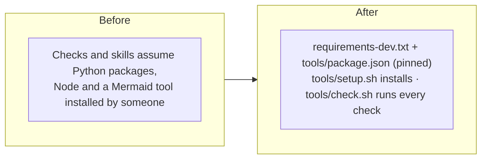

# 0015 · The repository carries the tools its agents need

Read this page to know which dependencies and executables an agent needs to run the checks and the skills of this repository, and why the repository holds them instead of the agent's machine.

**Status:** Proposed · 2026-11-15. Not confirmed by the project owner. The owner asked that the repository include these dependencies and executables; the choices below are not yet approved.

## Context

The checks and the two skills (`repo-docs-canvas`, `pending-decisions-canvas`) need `markdown-it-py`, PyYAML and, for diagrams, Node. The skill pages did not list them and `AGENTS.md` named only PyYAML, so an agent on another machine had to guess. The earlier Mermaid check asked for `mmdc`, which needs a browser, and the check that was actually used lived outside the repository.

## Decision

The repository declares and ships what its agents run.

| Part | Where | Notes |
|---|---|---|
| Python dependencies | `requirements-dev.txt` | `markdown-it-py` 4.3.0 and `PyYAML` 6.0.3, the versions tested |
| Node dependencies | `tools/package.json` and `tools/package-lock.json` | `jsdom` 31.0.1 and `mermaid` 12.3.0; installed with `npm ci` |
| Link, CSV, JSON and YAML check | `tools/check_docs.py` | Already in the repository |
| Mermaid check | `tools/check_mermaid.mjs` | Parses every diagram with Mermaid; no browser |
| Installer | `tools/setup.sh` | Checks for `python3`, `git` and `node`, then installs both sets |
| All checks | `tools/check.sh` | The command to run before every commit |

The requirements list lives in one place, [08-operations.md](../../../docs/08-operations.md#agent-tooling). `AGENTS.md` and the skills link to it.

## Alternatives

- **Install on the agent's machine and document it.** Nothing to maintain here, but each machine drifts, and a missing package shows up as a failure in the middle of a task.
- **`mmdc` (Mermaid CLI) for the diagram check.** It also renders, but it needs a headless browser. Parsing is enough to catch a diagram that does not load.
- **A `pyproject.toml` now.** The package arrives at milestone M1a; a requirements file is enough until then.
- **Make the Mermaid check optional.** Faster on a machine without Node, but a broken diagram would reach the site.

## Consequences

- An agent needs `python3`, `git` and Node 20 or later, then runs `tools/setup.sh` once.
- `tools/node_modules/` is not committed. The lockfile is, so installs are the same everywhere.
- Updating a dependency is a commit that changes the pin and reruns `tools/check.sh`.
- The owner still has to decide whether the Mermaid check is mandatory before each commit, as proposed, or optional.

## Next

- The requirements and the commands: [08-operations.md](../../../docs/08-operations.md#agent-tooling)
- Rules for agents: [AGENTS.md](../../../AGENTS.md)
- [0014 · What AAD-docs takes from the owner's other repositories](0014-reuse-from-the-owners-repositories.md)
