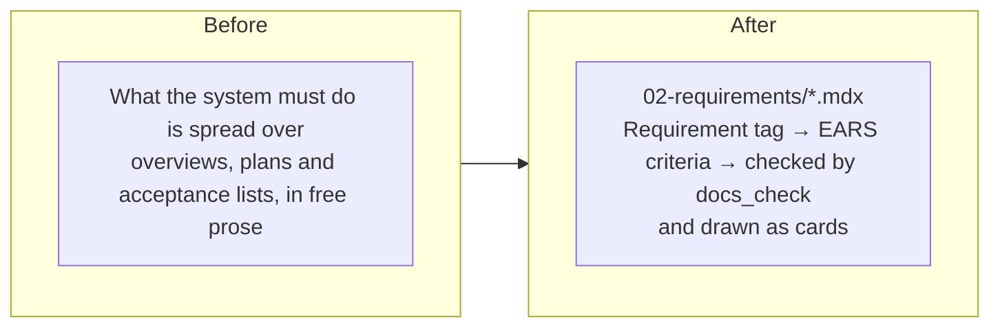

# 0016 · System requirements are written in EARS inside a `Requirement` tag

Read this page to know how a requirements page states what the system must do, how the app checks it, and why it uses one more tag of the closed registry instead of a convention in plain Markdown.



**Status:** Proposed · 2026-11-25. Not confirmed by the project owner.

## Context

A reader who changes the code needs to know what each part of the system must do and what happens when something fails. Today that knowledge lives in overviews, in the acceptance lists of the plan and in the heads of the people who wrote the code. Free prose lets a requirement say "should be fast" or leave out the failure case, and nothing checks it.

EARS (Easy Approach to Requirements Syntax) writes each requirement with a fixed sentence shape: an optional condition, the system, and what it shall do. Kiro already generates its specs in this form, so the criteria written here can be read by people and by agents that know it.

| Pattern | Keyword | Use it when |
|---|---|---|
| Ubiquitous | none | It is always true |
| Event-driven | `WHEN` | A single event triggers the response |
| State-driven | `WHILE` | It applies during a state |
| Unwanted behavior | `IF … THEN` | A fault or an error occurs |
| Optional feature | `WHERE` | It depends on a feature or a setting |
| Complex | several | Keywords combine in the order `WHERE`, `WHILE`, `WHEN` or `IF` |

## Decision

A requirements page is an `.mdx` file in a `02-requirements/` section of an app node. Each requirement is a `Requirement` container of the closed registry ([0013](0013-visual-components.md)). Its body is an optional sentence that says why the requirement exists, followed by a numbered list of criteria in EARS.

```mdx
<Requirement id="ACC-1" title="Access to the docs" status="proposed">
Only staff read the documentation unless the project opens it.

1. WHEN a user without staff status requests any `/docs/` address, THEN the app SHALL answer 403.
2. WHERE `ACCESS` is `"public"`, the app SHALL serve every page without sign-in.
3. IF a node's `__init__.py` raises on import, THEN the app SHALL skip that node and keep the rest.
</Requirement>
```

- **Registry.** `Requirement` is a container with the attributes `id` and `title` (required), `status` (`proposed`, `accepted` or `deprecated`) and `implements` (optional). It needs no JavaScript. It is a registry entry, a template and a test, like every component, and `mdx-tags.csv` is regenerated from it.
- **Parser.** A pure-Python module, `aad_docs/ears.py`, owns the patterns and their keywords. It reads a criterion and reports its pattern. It checks structure only: the keywords in a valid order and the word `SHALL`. It does not judge whether the sentence is good. `06-reference/ears-patterns.csv` is generated from it ([0012](0012-reference-tables-from-their-owner.md)).
- **Variants.** The parser also accepts `WHEN … THEN the system SHALL …`, the shape Kiro writes.
- **Languages.** The canonical keywords are English. A page in another language, such as `name.es.mdx`, may use the translated keywords that the same table lists. Both forms are read.
- **Identifiers.** The `id` is written by hand, is stable and is unique within a node. Criteria are numbered by position within their requirement, so `ACC-1.2` names the second criterion.
- **Status.** Only the owner moves a requirement from `proposed` to `accepted`, as for a decision. An agent writes `proposed`.
- **Checks.** New codes of `docs_check`, written in the registry of checks and generated into `checks.csv`:

| Code | Finding |
|---|---|
| D070 | A criterion follows no EARS pattern or lacks `SHALL` |
| D071 | A `Requirement` has no numbered list of criteria |
| D072 | Two requirements of one node share an `id` |
| D073 | A translated page has different `id` values or a different number of criteria than its source |
| D075 | `implements` names no model, route or code-map entry (active once traceability exists) |

- **One owner per fact.** The `.mdx` is the only owner of a requirement. Any index of requirements is a generated file, listed in `.generated.yml` ([0006](0006-one-owner-per-fact.md)).

## Alternatives

- **A convention in plain `.md`.** Criteria are numbered lines that the checker reads, and the page needs no new tag. It reads well on GitHub, but the app can only show it as a list, and nothing in the page marks where a requirement starts and ends.
- **Requirements in `.yml`.** Easy to validate, but `.yml` holds data written by a command, and a person writing prose in YAML loses the reason that goes with each requirement.
- **A free-text standard without a grammar.** It asks for no new work, and it lets vague requirements through, which is the problem this decision addresses.
- **Using EARS for the whole documentation.** It fits what the system does. It does not fit guides, the code map or the tone of an overview, which stay as they are.

## Consequences

- GitHub shows the tags of an `.mdx` as text, as it does for any other page of this kind. The criteria stay readable as numbered lines.
- A requirement with no `SHALL` is reported by `docs_check`, so a vague sentence is found before review.
- The tag set grows by one entry. Renaming its attributes later is a breaking change, as for any component.
- The failure case becomes a habit: the pattern `IF … THEN` asks for it.
- Requirements and decisions stay apart: a requirement says what the system does; a decision says why it was built that way, and `D032` reports a paragraph copied between them.
- Where the parser would reject a sentence that is clear to a person, the rule is the one to change, not the sentence.

## Next

- The registry the tag joins: [0013 · Pages use visual components from a closed registry](0013-visual-components.md)
- Why tables and indexes are generated: [0012 · Reference tables are generated from their owner in code](0012-reference-tables-from-their-owner.md)
- The plan to build it: [PLAN.md](../../../docs/PLAN.md)
