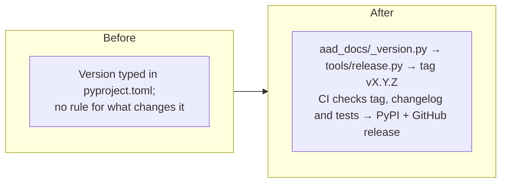

# 0017 · Versions follow SemVer, live in one file and are published by a tag

Read this page to know how AAD-docs numbers its versions, what counts as a breaking change and what happens between a tag and the package on PyPI.

**Status:** Proposed · 2026-11-25. The owner asked to establish the versioning; the scheme below is not yet approved.

## Context

A project that installs AAD-docs needs to know which upgrade is safe. The package had a version in `pyproject.toml`, a tag-triggered publish workflow and no rule for when to change the number, what a breaking change is or where the version is read from.

## Decision

| Item | Rule |
|---|---|
| Scheme | `X.Y.Z` as in SemVer 2.0, with an optional pre-release `aN`, `bN` or `rcN` (PEP 440) |
| Before 1.0.0 | A minor bump (`0.Y.0`) may break the public interface; a patch bump (`0.0.Z`) never does |
| From 1.0.0 | A major bump breaks, a minor bump adds, a patch bump fixes |
| Where it lives | `aad_docs/_version.py`, the only place. `pyproject.toml` reads it; `aad_docs.__version__` exposes it |
| Tag | `vX.Y.Z`, equal to the version. The publish workflow stops if they differ |
| Changelog | New entries go under `## Unreleased`. A release renames that section `## X.Y.Z · date` |
| How to release | `python3 tools/release.py X.Y.Z`, then check, commit, tag and push ([08-operations.md](../../../docs/08-operations.md#release)) |
| Pre-releases | A tag such as `v0.2.0rc1` publishes a pre-release on PyPI and on GitHub; `pip` skips it unless asked with `--pre` |
| Supported | The versions the CI matrix tests: Python 3.11 to 3.13 and Django 5.2. Dropping one is a minor bump before 1.0.0 and is listed in the changelog |
| A bad release | Yank it on PyPI and publish a patch. A version number is never reused |
| 1.0.0 | After milestone M5 closes, when a real project has used the app and the proposed decisions are settled |

The public interface, whose change is a breaking change:

- `aad_docs.Node`, `aad_docs.docs_url` and `aad_docs.__version__`.
- The keys of the `AAD_DOCS` setting and the options of a node.
- The tags of the registry and their attributes ([0013](0013-visual-components.md)).
- The file layout the app reads, and the addresses it gives pages ([0010](0010-addresses-from-metadata.md)).
- The names and options of the management commands, and the meaning of each check code.

Templates, CSS classes, internal modules and the vendored files are not public. A change that alters how a vendored file renders is noted in the changelog.

## Alternatives

- **Version from the git tag** (`setuptools-scm`). The tag and the version cannot disagree, but a build from a shallow clone or an archive gets a development number, and the number is not visible in the repository.
- **Calendar versions.** They say when, not whether an upgrade breaks something.
- **The version typed in `pyproject.toml`.** It works, and the package has no way to report its own version without reading its metadata.

## Consequences

- One file changes in a release, and a test fails if `pyproject.toml` stops reading it.
- The first release is `0.1.0`: the interface can still change in `0.2.0`.
- A release needs a changelog section, so a change without a note cannot ship.
- PyPI trusted publishing needs the owner to register the project once ([08-operations.md](../../../docs/08-operations.md#release)).

## Next

- How to cut a release: [08-operations.md](../../../docs/08-operations.md#release)
- The name and dependencies: [0008 · Package name, versions and dependencies](0008-package-name-and-dependencies.md)
