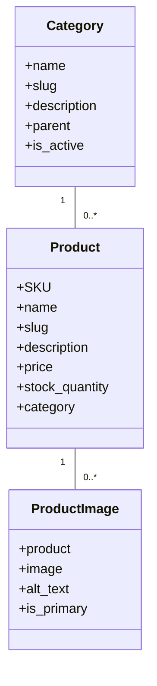

# Vista general del cat\u00e1logo de productos

La aplicaci\u00f3n de cat\u00e1logo gestiona productos, categor\u00edas e im\u00e1genes de productos para un sistema de comercio electr\u00f3nico.



## Caracter\u00edsticas

- **Categor\u00edas**: Estructura jer\u00e1rquica con relaciones padre-hijo
- **Productos**: Informaci\u00f3n completa con precios, stock y descripciones
- **Im\u00e1genes**: M\u00faltiples im\u00e1genes por producto con orden primario/secundario
- **Traducciones**: Soporte completo en espa\u00f1ol

## Inicio r\u00e1pido

1. Crear una categor\u00eda:
   ```python
   from demo.catalog.models import Category
   
   electronica = Category.objects.create(
       name="Electr\u00f3nica",
       slug="electronica",
       description="Todos los productos electr\u00f3nicos"
   )
   ```

2. Crear un producto:
   ```python
   from demo.catalog.models import Product
   
   telefono = Product.objects.create(
       SKU="IPHONE-15-PRO",
       name="iPhone 15 Pro",
       slug="iphone-15-pro",
       category=electronica,
       price=999.00,
       stock_quantity=100
   )
   ```

## Pr\u00f3ximos pasos

- [Referencia de modelos](02-models.md) - Documentaci\u00f3n detallada de campos
- [Gu\u00eda de uso](03-usage.md) - C\u00f3mo usar el cat\u00e1logo en tu proyecto
