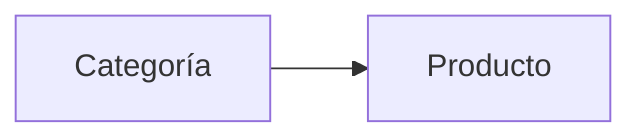

# Qué es el catálogo de demostración

Lee esta página para saber qué hace el catálogo de demostración.

## Qué hace

El catálogo agrupa productos por categoría para mostrar cómo AAD-docs documenta los modelos de una aplicación.

## Qué leer después

- Qué es AAD-docs: [01-overview.es.md](../../../aad_docs/docs/01-overview.es.md)
