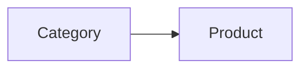

# Catalog overview

Read this page to know what the demo catalog app does and how its models relate.

## What it does

`demo.catalog` is the sample app shipped with AAD-docs to test model metadata extraction, diagrams and translations.

## Next

- Browse AAD-docs itself: [01-overview.md](../../../aad_docs/docs/01-overview.md)
