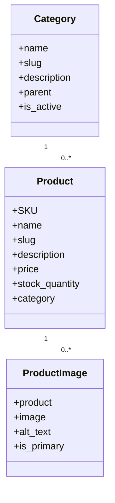

# Product Catalog Overview

The catalog app manages products, categories, and product images for an e-commerce system.



## Features

- **Categories**: Hierarchical category structure with parent-child relationships
- **Products**: Full product information with pricing, stock, and descriptions
- **Images**: Multiple images per product with primary/secondary ordering
- **Translations**: Full Spanish support for model verbose names and help texts

## Quick Start

1. Create a category:
   ```python
   from demo.catalog.models import Category
   
   electronics = Category.objects.create(
       name="Electronics",
       slug="electronics",
       description="All electronic products"
   )
   ```

2. Create a product:
   ```python
   from demo.catalog.models import Product
   
   phone = Product.objects.create(
       SKU="IPHONE-15-PRO",
       name="iPhone 15 Pro",
       slug="iphone-15-pro",
       category=electronics,
       price=999.00,
       stock_quantity=100
   )
   ```

## Next Steps

- [Model Reference](02-models.md) - Detailed field documentation
- [Usage Guide](03-usage.md) - How to use the catalog in your project
