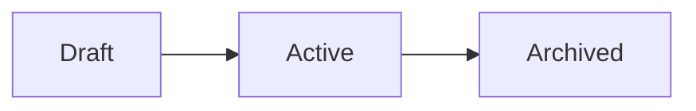

# Product lifecycle

Read this page to see how a product moves from draft to active in the catalog.

## States

- **Draft**: created in inventory before pricing is confirmed.
- **Active**: visible in the store catalog.
- **Archived**: retired from sale.

## Next

- Catalog overview: [01-overview.md](../01-overview.md)
