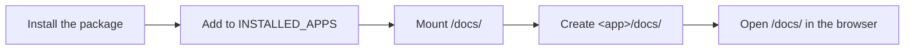

# Getting started

Follow this page to install AAD-docs in a Django project and see your first documentation page.



**Status: release candidate.** The package implementation exists; the PyPI installation command will work after the first release is published.

## Before you start

- A Django project that runs locally.
- Python 3.11 or later and Django 5.2 or later. These versions are proposed in [decision 0008](../aad_docs/docs/07-decisions/0008-package-name-and-dependencies.md).
- A staff user. The documentation is staff-only by default.

## Steps

1. Install the package.

   ```bash
   pip install aad-docs
   ```

   Before the initial PyPI release, use `pip install git+https://github.com/AADigitalBusiness/AAD-docs.git` instead.

2. Add the app to `INSTALLED_APPS`.

   ```python
   INSTALLED_APPS = [
       # ...
       "aad_docs",
   ]
   ```

3. Mount the URLs.

   ```python
   # urls.py
   from django.urls import include, path

   urlpatterns = [
       # ...
       path("i18n/", include("django.conf.urls.i18n")),
       path("docs/", include("aad_docs.urls")),
   ]
   ```

   The language switcher posts to Django's `set_language` view, so it needs the `i18n/` URLs and `django.middleware.locale.LocaleMiddleware` in `MIDDLEWARE`.

4. Create the documentation folder of one app.

   ```bash
   mkdir orders/docs
   touch orders/docs/__init__.py
   echo "# Orders" > orders/docs/01-overview.md
   ```

5. Run the server and open the page.

   ```bash
   python manage.py runserver
   ```

   Open `http://localhost:8000/docs/orders/`.

## Result

The page shows a menu with one node, `Orders`, and the overview page you wrote. An empty `__init__.py` is enough: the slug comes from the app name and the title from its `verbose_name`.

## Work on AAD-docs itself

The `demo/` project installs the app and points `AAD_DOCS["ROOT"]` at this repository's `docs/`, so the demo renders this documentation.

```bash
pip install -e ".[dev]"
python demo/manage.py check
pytest
python demo/manage.py runserver
```

## Next

- Give the node a title, an order and a page list: [document-an-app.md](../aad_docs/docs/05-guides/document-an-app.md)
- If the node does not appear, run `python manage.py docs_check` and read [checks.csv](../aad_docs/docs/06-reference/checks.csv).
