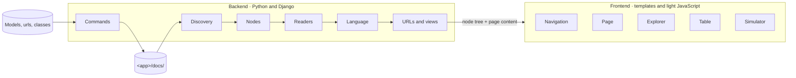
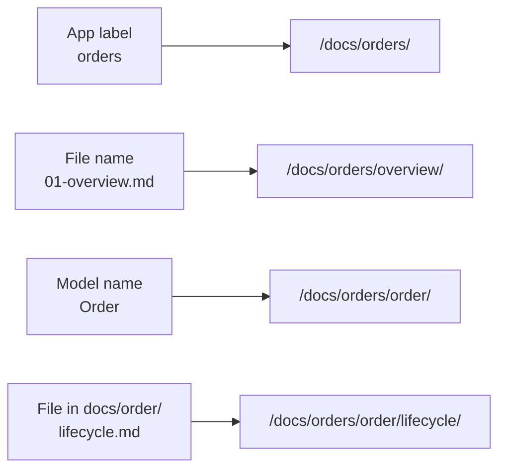
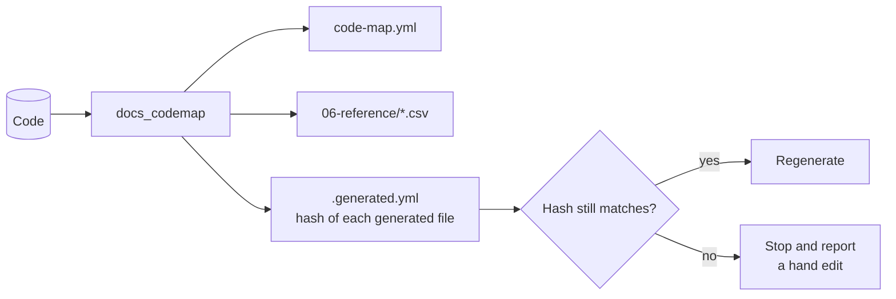

# Architecture

Read this page to understand how AAD-docs is built: its components, the data that moves between them, and the one contract that separates backend from frontend.



**Status: design.** No component exists yet. The [plan](PLAN.md) says when each one is built.

## The contract

The backend hands the frontend a node tree with the content already read. The frontend never opens a file.

| Object | Field | Meaning |
|---|---|---|
| Node | `slug` | Address segment: `/docs/<slug>/` |
| Node | `title` | Shown in the menu, in the active language |
| Node | `order` | Position among its siblings |
| Node | `pages` | List of Page |
| Node | `children` | List of Node, one per subfolder that has an `__init__.py` |
| Page | `slug` | File stem without its numeric prefix: `01-overview` becomes `overview` |
| Page | `title` | First heading of a `.md`; file stem for data files |
| Page | `kind` | `md`, `mdx`, `yml`, `csv` or `json` |
| Page | `languages` | Languages the page exists in |
| Page | `content` | HTML for `md`; HTML with the data of each embedded piece for `mdx`; parsed data for the other kinds |

## Backend

| Component | Does | Delivers |
|---|---|---|
| Discovery | Walks `INSTALLED_APPS` and the root folder, finds each `docs/` that has an `__init__.py` | List of folders |
| Nodes | Imports each `__init__.py`, reads `node`, applies defaults | Node tree |
| Readers | One reader per extension turns a file into data | Page content |
| Language | Picks `name.es.md` when Spanish is active, falls back to `name.md` | Page in the requested language |
| Routing | Turns an address into a node, a model or a page, and a model or an app into its address | The target of a request; `docs_url()` |
| URLs and views | Serves every address under `/docs/`; checks access | One response per node, model or page |
| Commands | `docs_codemap`, `docs_check`, `docs_screenshots` | Generated files in the repository |

Rules the backend enforces:

- Only `.md`, `.mdx`, `.yml`, `.csv` and `.json` are read. Images under `assets/` are served, never listed as pages. Files and folders that start with a dot are ignored.
- A folder without `__init__.py` is not a node. The one exception is a folder named after a model slug: the model resolves it.
- An `.mdx` is Markdown plus a closed list of tags. The reader replaces each tag with its piece; it runs no JavaScript and compiles nothing.
- The tree is built once per process and cached. In `DEBUG` it is rebuilt on every request.
- A page path is resolved against the node's folder and may not leave it.

## Frontend

| Component | Does | Reads |
|---|---|---|
| Navigation | Menu with the node tree and a language switcher | Node tree |
| Page | Draws the HTML of a `.md` or `.mdx`, runs Mermaid, shows screenshots, mounts the embedded pieces | `md` and `mdx` content |
| Explorer | Click-through view of the code map: route, view, service, model | `code-map.yml` |
| Table | Sorts and filters | `csv` content |
| Simulator | Steps through a flow | `json` content with `"type": "flow"` |
| Style | Applies the visual standard and the page anatomy | All of the above |

The frontend is Django templates and plain JavaScript shipped inside the package. This is proposed, not settled: see [decision 0007](../aad_docs/docs/07-decisions/0007-frontend-django-templates.md).

## Addresses

Every page has a fixed address on the live site. Nobody configures it: it comes from the metadata of the app and of the model. Any part of the project can then link to the documentation of an app or a model without writing a path, and the link holds for as long as the app and the model keep their names.



| Address | Shows | The slug comes from |
|---|---|---|
| `/docs/` | The index: the root node and the list of apps | |
| `/docs/<app-slug>/` | The node of the app | The app `label`, with hyphens for underscores |
| `/docs/<app-slug>/<file-name>/` | A page of the app | The file name, without numeric prefix or extension |
| `/docs/<app-slug>/<section>/<file-name>/` | A page inside a section, such as guides or decisions | The folder name, without numeric prefix |
| `/docs/<app-slug>/<model-slug>/` | The page of the model, generated from its metadata | The `model_name` of the model |
| `/docs/<app-slug>/<model-slug>/<file-name>/` | A hand-written page about that model | A file inside `<app>/docs/<model-slug>/` |

- The page of a model exists without any file. Hand-written pages about it go in a folder named after its slug, which needs no `__init__.py`.
- The app slug can be changed with `slug` in its `__init__.py`. The model slug cannot.
- The root node follows the same scheme with its own slug.
- The project chooses the `/docs/` prefix when it mounts the URLs.
- The language is not part of the address. One address shows the page in the active language.
- A section and a model of the same app that produce the same slug collide; `docs_check` reports it.

To link to the documentation from code or from a template, ask for the address:

```python
from aad_docs import docs_url

docs_url("orders")            # /docs/orders/
docs_url(Order)               # /docs/orders/order/
docs_url(Order, "lifecycle")  # /docs/orders/order/lifecycle/
```

## Generated files

Commands write files; people write pages. The two never share a file.



- `docs_codemap` reads model metadata (`_meta`, field options, docstrings), the URL resolver and class docstrings.
- Each `docs/` folder holds a `.generated.yml` manifest with the hash of every generated file. A file whose hash no longer matches was edited by hand: the command stops instead of overwriting it.
- No command ever writes a `.md`.

## Next

- Where each component lives in the code: [04-code-map.md](../aad_docs/docs/04-code-map.md)
- How one request travels: [request-flow.json](../aad_docs/docs/request-flow.json)
- Why it is built this way: [07-decisions/](../aad_docs/docs/07-decisions/)
