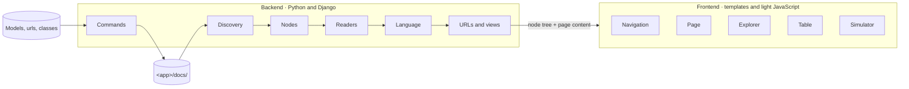
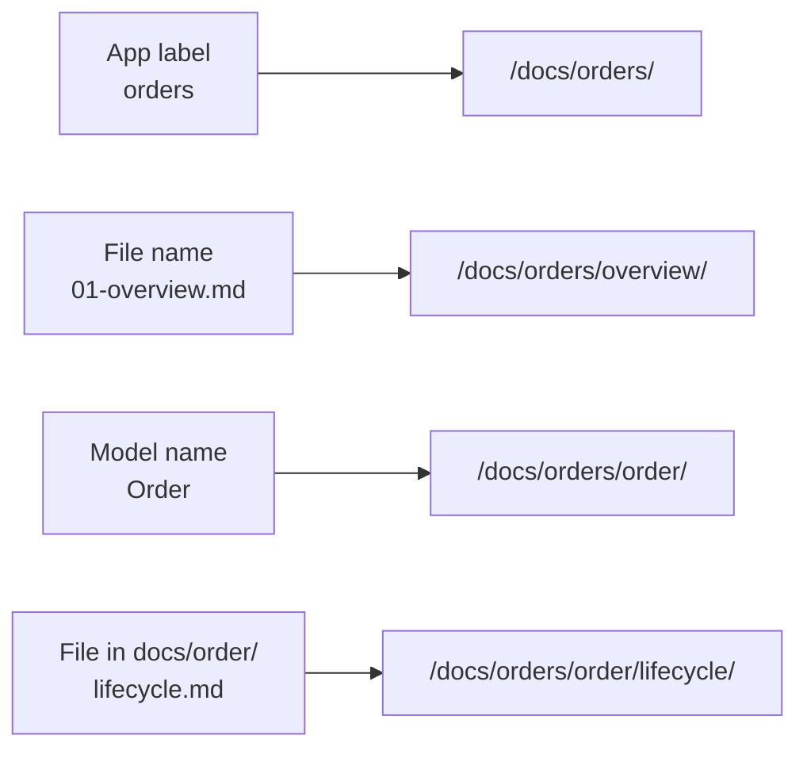
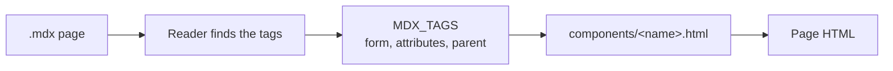
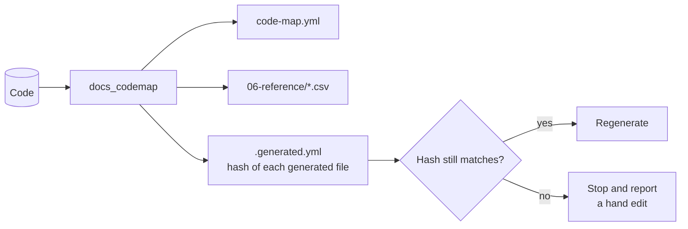

# Architecture

Read this page to understand how AAD-docs is built: its components, the data that moves between them, and the one contract that separates backend from frontend.



**Status: design.** No component exists yet. The [plan](PLAN.md) says when each one is built.

## The contract

The backend hands the frontend a node tree with the content already read. The frontend never opens a file.

| Object | Field | Meaning |
|---|---|---|
| Node | `slug` | Address segment: `/docs/<slug>/` |
| Node | `title` | Shown in the menu, in the active language |
| Node | `order` | Position among its siblings |
| Node | `pages` | List of Page |
| Node | `children` | List of Node, one per subfolder that has an `__init__.py` |
| Page | `slug` | File stem without its numeric prefix: `01-overview` becomes `overview` |
| Page | `title` | First heading of a `.md`; file stem for data files |
| Page | `kind` | `md`, `mdx`, `yml`, `csv` or `json` |
| Page | `languages` | Languages the page exists in |
| Page | `variants` | The file of each language: `01-overview.md`, `01-overview.es.md` |
| Page | `frontmatter` | `source` and `synced` of a Spanish page; never part of `content` |
| Page | `content` | HTML for `md`; HTML with the data of each embedded piece for `mdx`; parsed data for the other kinds |

## Backend

| Component | Does | Delivers |
|---|---|---|
| Settings | `DEFAULTS` in `conf.py`, merged under `settings.AAD_DOCS` | The value of every setting |
| Discovery | Walks `INSTALLED_APPS` and the root folder, finds each `docs/` that has an `__init__.py` | List of folders |
| Nodes | Loads each `__init__.py` by path, reads `node`, applies defaults | Node tree |
| Readers | One reader per extension turns a file into data | Page content |
| Language | Picks `name.es.md` when Spanish is active, falls back to `name.md` | Page in the requested language |
| Routing | Turns an address into a node, a model or a page, and a model or an app into its address | The target of a request; `docs_url()` |
| URLs and views | Serves every address under `/docs/`; checks access | One response per node, model or page |
| Commands | `docs_codemap`, `docs_check`, `docs_screenshots` | Generated files in the repository |

Rules the backend enforces:

- Only `.md`, `.mdx`, `.yml`, `.csv` and `.json` are read. Files and folders that start with a dot are ignored.
- Images under `assets/` are served from a closed list of types (`.png`, `.jpg`, `.jpeg`, `.webp`, `.gif`) and never listed as pages. SVG is not served, because it can carry scripts.
- A folder without `__init__.py` is not a node. The one exception is a folder named after a model slug: the model resolves it.
- Every `__init__.py` is loaded by file path under a unique module name, inside a guard. A node that fails is skipped and reported (D003), never fatal. The package `aad_docs` imports no Django code, so a node file can `from aad_docs import Node` before Django is ready; `docs_url` loads the routing on its first call.
- Siblings sort by `order`, then by `slug`. When a node lists `pages`, only those items show, in that order, and the rest is hidden. Without `pages`, every readable file and child node shows, sorted by name. `visible(request, page_name)` filters the menu and the access to the page.
- Language variants are one page. `name.es.md` next to `name.md` is a variant of the same page, never a second page. The active Django language is normalized against `LANGUAGES` (`es-co` becomes `es`) and falls back to the first language. The header of a Spanish page is removed before rendering.
- Raw HTML is never rendered: a tag that the registry does not list shows as text. The semantic tags the registry lists, such as `details` and `summary`, are read in `.md` and `.mdx`. An `.mdx` is Markdown plus a closed list of tags. A tag stands alone on its line or is a container that opens and closes on its own lines. The reader replaces each tag with its component, leaves tags inside code as text, runs no JavaScript and compiles nothing. The `src` of a tag resolves inside the folder of its node.
- The tree is built once per process and cached. In `DEBUG` it is rebuilt on every request.
- A page path is resolved against the node's folder and may not leave it. When a section and a model produce the same slug, the section answers.
- The checks of the app run with `manage.py check`, as Django system checks.

## Frontend

| Component | Does | Reads |
|---|---|---|
| Navigation | Menu with the node tree and a language switcher | Node tree |
| Page | Draws the HTML of a `.md` or `.mdx`, runs Mermaid, shows screenshots, mounts the embedded pieces | `md` and `mdx` content |
| Explorer | Click-through view of the code map: route, view, service, model | `code-map.yml` |
| Table | Sorts and filters | `csv` content |
| Simulator | Steps through a flow | `json` content with `"type": "flow"` |
| Style | Applies the visual standard and the page anatomy | All of the above |

- Mermaid is a vendored static file of a pinned version, with its license beside it, and runs with `securityLevel: 'strict'`.
- The language switcher posts to Django's `set_language` view.

The frontend is Django templates and plain JavaScript shipped inside the package. This is proposed, not settled: see [decision 0007](../aad_docs/docs/07-decisions/0007-frontend-django-templates.md).

## Addresses

Every page has a fixed address on the live site. Nobody configures it: it comes from the metadata of the app and of the model. Any part of the project can then link to the documentation of an app or a model without writing a path, and the link holds for as long as the app and the model keep their names.



| Address | Shows | The slug comes from |
|---|---|---|
| `/docs/` | The index: the root node and the list of apps | |
| `/docs/<app-slug>/` | The node of the app | The app `label`, with hyphens for underscores |
| `/docs/<app-slug>/<file-name>/` | A page of the app | The file name, without numeric prefix or extension |
| `/docs/<app-slug>/<section>/<file-name>/` | A page inside a section, such as guides or decisions | The folder name, without numeric prefix |
| `/docs/<app-slug>/<model-slug>/` | The page of the model, generated from its metadata | The `model_name` of the model |
| `/docs/<app-slug>/<model-slug>/<file-name>/` | A hand-written page about that model | A file inside `<app>/docs/<model-slug>/` |

- The page of a model exists without any file. Hand-written pages about it go in a folder named after its slug, which needs no `__init__.py`.
- The app slug can be changed with `slug` in its `__init__.py`. The model slug cannot.
- The root node follows the same scheme with its own slug.
- The project chooses the `/docs/` prefix when it mounts the URLs.
- The language is not part of the address. One address shows the page in the active language.
- A section and a model of the same app that produce the same slug collide: the section answers and `docs_check` reports it (D007). Two files of one folder with the same slug collide too (D008).

To link to the documentation from code or from a template, ask for the address:

```python
from aad_docs import docs_url

docs_url("orders")            # /docs/orders/
docs_url(Order)               # /docs/orders/order/
docs_url(Order, "lifecycle")  # /docs/orders/order/lifecycle/
```

## Components

A page gets its visual elements from a closed registry. The author writes a tag; the reader checks it against the registry and renders a Django template.



| Component | Form | Shows |
|---|---|---|
| `Callout` | container | A note, tip, warning or danger box |
| `Steps` | container | A numbered list drawn as a sequence |
| `Tabs`, `Tab` | container | Alternatives, one panel for each tab |
| `Cards`, `Card` | container | A grid of linked cards |
| `details`, `summary` | container | A section the reader opens and closes; read in `.md` and `.mdx` |
| `Model`, `ModelDiagram`, `Table`, `Explorer`, `Flow`, `Screenshot` | line | The pieces that read data files and model metadata |

- The registry owns [mdx-tags.csv](../aad_docs/docs/06-reference/mdx-tags.csv), which lists every attribute.
- Templates use the classes of the design system. Each component declares in the registry whether it needs JavaScript: `none`, `enhance` or `required`. A page loads only the static scripts its components ask for, and none is inline.
- The reasons and the alternatives: [decision 0013](../aad_docs/docs/07-decisions/0013-visual-components.md).

## Generated files

Commands write files; people write pages. The two never share a file.



- `docs_codemap` reads model metadata (`_meta`, field options, docstrings), the URL resolver and class docstrings.
- Each `docs/` folder holds a `.generated.yml` manifest with the hash of every generated file. A file whose hash no longer matches was edited by hand: the command stops instead of overwriting it.
- No command ever writes a `.md`.
- A file that exists without an entry in `.generated.yml` and belongs to the initial design-target set is replaced once by the first run, and its hash is recorded. The set is `code-map.yml` and the tables of `06-reference/`, each entering when its generator exists. `request-flow.json` is not in it: nothing generates it.

### Reference tables

Each table in `06-reference/` is generated from one owner in Python, and the code never reads the table back: [decision 0012](../aad_docs/docs/07-decisions/0012-reference-tables-from-their-owner.md).

| Table | Owner |
|---|---|
| `settings.csv` | `conf.DEFAULTS` |
| `node-options.csv` | `nodes.Node` |
| `mdx-tags.csv` | `readers.mdx.MDX_TAGS` |
| `file-types.csv` | The registry of readers |
| `commands.csv` | The `docs_*` commands |
| `checks.csv` | `checks.CHECKS` |

## Next

- Where each component lives in the code: [04-read-the-code.md](../aad_docs/docs/04-read-the-code.md)
- How one request travels: [request-flow.json](../aad_docs/docs/request-flow.json)
- Why it is built this way: [07-decisions/](../aad_docs/docs/07-decisions/)
