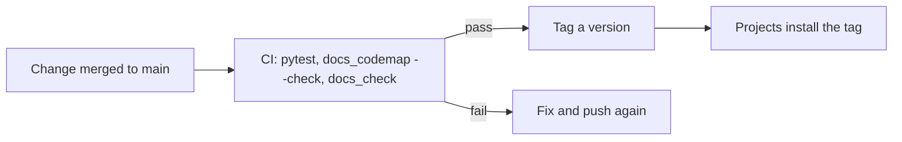

# Operations

Use this page to release AAD-docs, run its checks in CI and control who can read the documentation.



**Status: planned.** CI and releases start at milestone M1a of the [plan](PLAN.md).

## Release

1. Update `CHANGELOG.md`.
2. Tag the version.

   ```bash
   git tag v0.1.0
   git push origin v0.1.0
   ```

3. In each project, install the tag.

   ```bash
   pip install git+ssh://git@github.com/AADigitalBusiness/AAD-docs.git@v0.1.0
   ```

## Checks in CI

In this repository, `tools/check.sh` is the check of every pull request until `docs_check` exists ([Agent tooling](#agent-tooling)). In every project that installs the app, run these on every pull request.

```bash
pytest
python manage.py docs_codemap --check
python manage.py docs_check
```

- `docs_codemap --check` fails when the generated files are out of date with the code.
- `docs_check` fails on the rules listed in [checks.csv](../aad_docs/docs/06-reference/checks.csv).

## Access

The documentation exposes models, routes and class names. Treat it as internal.

- Default: only staff users can open `/docs/`.
- Change it with the `ACCESS` setting: see [settings.csv](../aad_docs/docs/06-reference/settings.csv).
- A node can hide a page per request, because `__init__.py` is Python.
- Raw HTML is never rendered, so no page can run a script, whatever `ACCESS` says. Only the tags of the registry, such as `details`, are read as tags; any other shows as text.
- Scripts load from static files only, and only those that the components of a page need. A policy that allows own scripts only (`script-src 'self'`) works.
- Only `.png`, `.jpg`, `.jpeg`, `.webp` and `.gif` are served from `assets/`. SVG is not, because it can carry scripts.
- Mermaid runs in strict mode.
- A path is resolved inside the folder of its node and never outside it.

## Packaging

`docs/` folders hold non-Python files. AAD-docs declares `aad_docs/docs/**`, templates and static files as package data in `pyproject.toml`, and a Django system check warns when the packaged `docs/` is missing. A distributed app of yours must declare its own, or only the `.py` files ship.

## Update the design system

AAD-docs vendors the compiled `docs-light` theme so an installed Django project needs neither npm nor access to the design-system repository. The pin and checksum are in `aad_docs/static/aad_docs/vendor/plt-design-system.PROVENANCE.txt`.

1. Check out the chosen `plt-design-system` commit and run its design-system checks, including `build:themes`.
2. Copy `packages/design-system/demo/dist-docs-light.css` to `aad_docs/static/aad_docs/vendor/plt-design-system.css`.
3. Update the version, commit and SHA-256 in the provenance file.
4. Run the AAD-docs tests and `tools/check.sh`.

Keep environment-specific layout in `docs.css`. Shared tokens, primitives, visual states and accessibility fixes belong upstream in `plt-design-system`; update the pin instead of forking them here ([0014](../aad_docs/docs/07-decisions/0014-reuse-from-the-owners-repositories.md)).

## Retake guide screenshots

Install the optional browser tooling once and start the project locally.

```bash
pip install -e '.[screenshots]'
playwright install chromium
python demo/manage.py runserver 8001
```

In another terminal, capture the English and Spanish guide pages from that server.

```bash
python demo/manage.py docs_screenshots --base-url http://127.0.0.1:8001
```

The command is adapted from the installed `django-dsadmin` commit `4798410`. It writes real full-page captures under `aad_docs/docs/assets/` and stops on a missing browser, unreachable server or non-success response.

## Agent instructions

`AGENTS.md` at the root is the standard entry for coding agents ([agents.md](https://github.com/agentsmd/agents.md)): plain Markdown that holds the checks, conventions and rules an agent follows. `CLAUDE.md` only imports it (`@AGENTS.md`), so there is one file to maintain. `AGENTS.md` links to the documents that own each fact and does not repeat them.

Skills for agents live in `.claude/skills/<name>/`, each with a `SKILL.md` and, when it needs them, a `scripts/` folder. The skills and their use are listed in `AGENTS.md`. A skill never edits the documentation to produce its output.

## Agent tooling

What an agent needs to run the checks and the skills of this repository ([0015](../aad_docs/docs/07-decisions/0015-the-repository-carries-its-agent-tooling.md)).

| Requirement | Used by | How it arrives |
|---|---|---|
| `python3`, `git`, Node 20 or later | Everything below | Installed on the machine; `tools/setup.sh` stops if one is missing |
| `markdown-it-py`, `PyYAML` | The canvas script, `tools/check_docs.py` | `requirements-dev.txt`, installed by `tools/setup.sh` |
| `jsdom`, `mermaid` | `tools/check_mermaid.mjs` | `tools/package.json` with its lockfile, installed by `tools/setup.sh` |
| Write access to `origin` | Commit and push | Credentials of the session or the machine |
| The `Artifact` tool | Publishing the canvas | Provided by the session |
| The `ArtifactData` tool | Reading approvals | Provided by the session; load it first if it is deferred |
| The `ArtifactComments` tool | Answering comments on the canvas | Provided by the session; load it first if it is deferred |

Run `tools/setup.sh` once, then `tools/check.sh` before every commit. The canvas needs no network access on the agent's machine; the reader's browser loads the fonts.

## If something fails

| Symptom | Check |
|---|---|
| A node is missing from the menu | The folder has an `__init__.py`; the app is in `INSTALLED_APPS` |
| A page shows in English with Spanish active | The `.es.md` file exists next to the English one |
| `docs_codemap` stops without writing | A generated file was edited by hand; restore it or delete it and rerun |
| Docs are missing after `pip install` | `docs/` is not declared as package data |
| A node file raises on import | `docs_check` reports D003; the node is skipped and the rest keeps working |
