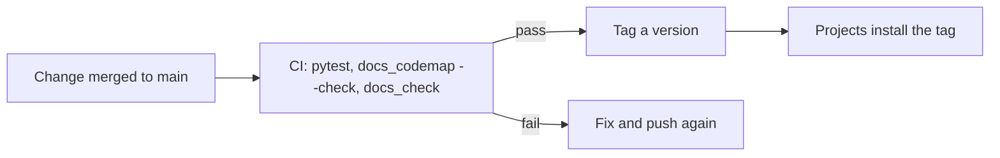

# Operations

Use this page to release AAD-docs, run its checks in CI and control who can read the documentation.



**Status: planned.** CI and releases start at milestone M1a of the [plan](PLAN.md).

## Release

1. Update `CHANGELOG.md`.
2. Tag the version.

   ```bash
   git tag v0.1.0
   git push origin v0.1.0
   ```

3. In each project, install the tag.

   ```bash
   pip install git+ssh://git@github.com/AADigitalBusiness/AAD-docs.git@v0.1.0
   ```

## Checks in CI

Run these on every pull request, in this repository and in every project that installs the app.

```bash
pytest
python manage.py docs_codemap --check
python manage.py docs_check
```

- `docs_codemap --check` fails when the generated files are out of date with the code.
- `docs_check` fails on the rules listed in [checks.csv](../aad_docs/docs/06-reference/checks.csv).

## Access

The documentation exposes models, routes and class names. Treat it as internal.

- Default: only staff users can open `/docs/`.
- Change it with the `ACCESS` setting: see [settings.csv](../aad_docs/docs/06-reference/settings.csv).
- A node can hide a page per request, because `__init__.py` is Python.
- Markdown is rendered with raw HTML disabled, so a public setting does not let a page run scripts.
- Only `.png`, `.jpg`, `.jpeg`, `.webp` and `.gif` are served from `assets/`. SVG is not, because it can carry scripts.
- Mermaid runs in strict mode.
- A path is resolved inside the folder of its node and never outside it.

## Packaging

`docs/` folders hold non-Python files. AAD-docs declares `aad_docs/docs/**`, templates and static files as package data in `pyproject.toml`, and a Django system check warns when the packaged `docs/` is missing. A distributed app of yours must declare its own, or only the `.py` files ship.

## If something fails

| Symptom | Check |
|---|---|
| A node is missing from the menu | The folder has an `__init__.py`; the app is in `INSTALLED_APPS` |
| A page shows in English with Spanish active | The `.es.md` file exists next to the English one |
| `docs_codemap` stops without writing | A generated file was edited by hand; restore it or delete it and rerun |
| Docs are missing after `pip install` | `docs/` is not declared as package data |
| A node file raises on import | `docs_check` reports D003; the node is skipped and the rest keeps working |
