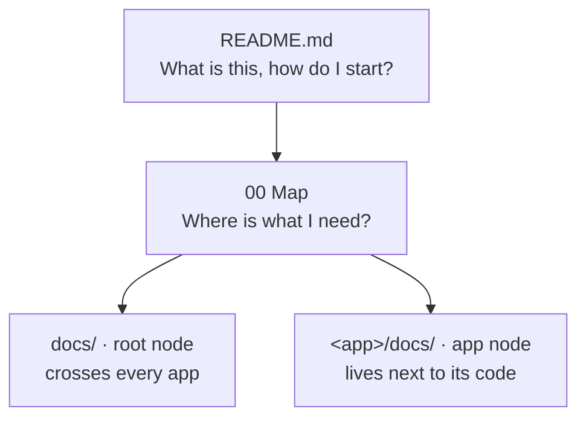

# How the docs work

Read this page to write, place and maintain a document in the AAD-docs standard.



## Where a document goes

| Document | Answers | Lives in | Tone |
|---|---|---|---|
| `README.md` | What is this and how do I start in five minutes? | Repository root | Practical, direct |
| `00-map.md` | Where do I find what I need? | Root node | Index, no prose |
| `01-overview.md` | What is it for, and what does it not do? | App node | Explanatory, brief |
| `02-getting-started.md` | How do I get it running? | Root node | Imperative, copyable commands |
| `03-architecture.md` | How is it built? | Root node | Technical, with diagrams |
| `04-code-map.md` | Where do I start reading the code? | App node | Entry points only |
| `05-guides/` | How do I do task X? | App node | Step by step |
| `06-reference/` | What are the exact parameters? | App node | Tables, exhaustive |
| `07-decisions/` | Why was it done this way? | App node | Context, alternatives, consequences |
| `08-operations.md` | How do I keep it running? | Root node | Checklists, runbooks |

The minimum for a project is three files: `README.md`, `00-map.md` and `02-getting-started.md`. Add the rest when its absence hurts.

## Anatomy of a page

Every page opens the same way and closes the same way, so nobody has to explain how to read it.

| Part | Content | Required on |
|---|---|---|
| 1 · Purpose | One line: what you get from reading the page | Every page |
| 2 · Diagram | The whole idea before any text | Every page |
| 3 · Before you start | What you need to have or know, with links | Pages where the reader does something |
| 4 · Steps | Numbered, each with a copyable command or a screenshot | Pages where the reader does something |
| 5 · Result | How you know it worked | Pages where the reader does something |
| 6 · Next | Where to go after, and where to go if it failed | Every page |

## File types

The app reads four extensions: `.md`, `.yml`, `.csv` and `.json`. What each one holds, who writes it and how it is shown is in [file-types.csv](../aad_docs/docs/06-reference/file-types.csv).

- Write pages as `.md`. Everything else is data that the app draws as an interactive view.
- Screenshots are the only other file allowed. They live in `<app>/docs/assets/` and are only linked from a `.md`.

## Tone

- Second person, imperative: "Run…", "Set…".
- What and why first, how after.
- Commands are always copyable, never described in prose.
- An explanation longer than two paragraphs belongs in architecture or in a decision, not in the README.
- Define a technical term the first time it appears.

## Visual standard

- Diagrams are Mermaid inside the Markdown. GitHub draws them, and they are reviewed in the same pull request as the code.
- One diagram, one idea. If it does not read at a glance, split it.
- Names in a diagram are the real names in the code.
- Model and route diagrams are generated from the code. Only architecture and flow diagrams are drawn by hand.
- Color only with meaning: one accent for the entry point.
- A decision shows the state before and after it.

## Languages

English is the source and the only language for technical documents. Spanish covers what a non-technical user reads.

| Document | English | Spanish |
|---|---|---|
| README | Full | Short: what it is and how to use it (`README.es.md`) |
| `01-overview` | Yes | Yes (`01-overview.es.md`) |
| A guide a non-technical user performs | Yes | Yes (`name.es.md`) |
| Everything else | Yes | No |

- A Spanish page sits next to its English source with the suffix `.es.md`. Both are the same page.
- Spanish is written for the person who uses the system: no jargon, no commands, a screenshot on each step.
- A Spanish page starts with a header that names its source and the date it was synced. `docs_check` reports it when the source changed after that date.

  ```yaml
  ---
  source: 01-overview.md
  synced: 2026-11-14
  ---
  ```

- Model names and help texts come out in Spanish from Django translations (`gettext_lazy`). Do not copy them into `docs/`.

## One owner per fact

Each fact has one owner. Every other place links to it or displays it, and never copies it.

| Fact | Owner | Not repeated in |
|---|---|---|
| Name, fields, types and relations of a model | Model metadata: `Meta`, field options | Any `.md`; any hand-written `.csv` |
| What a model, view or service is | Its docstring | `04-code-map.md` |
| Routes, views and classes that exist | The code, through `code-map.yml` | `04-code-map.md`, guides |
| What the app is for, when to use it | `01-overview.md` and the guides | `help_text`, docstrings |
| How to do a task | `05-guides/` | README, overview |
| Why it was designed this way | `07-decisions/` | Comments, docstrings, README |
| How to run the project | `02-getting-started.md` | README, which only links |

- A file is generated or hand-written, never both.
- Commands write only generated files and never touch a `.md`.
- A command that finds a generated file edited by hand stops and reports it.
- If a `.md` and the model disagree, the model wins.

## Maintain

| Task | Do |
|---|---|
| Add a page | Create the file in the right folder; add it to `pages` in `__init__.py` if the node lists pages |
| Add a section | Create a subfolder with an `__init__.py` |
| Refresh the code map and reference tables | `python manage.py docs_codemap` |
| Retake screenshots | `python manage.py docs_screenshots` |
| Find stale, broken or repeated content | `python manage.py docs_check` |

## Status of this repository

Until the commands exist, three kinds of file here are written by hand as the design target: `code-map.yml`, `request-flow.json` and the tables in `06-reference/`. `code-map.yml` and the reference tables become generated at milestone 2, and the first run replaces them. No screenshots exist yet; `docs_screenshots` takes them at milestone 4.

## Next

- Document one of your apps: [document-an-app.md](../aad_docs/docs/05-guides/document-an-app.md)
- Exact options of a node: [node-options.csv](../aad_docs/docs/06-reference/node-options.csv)
