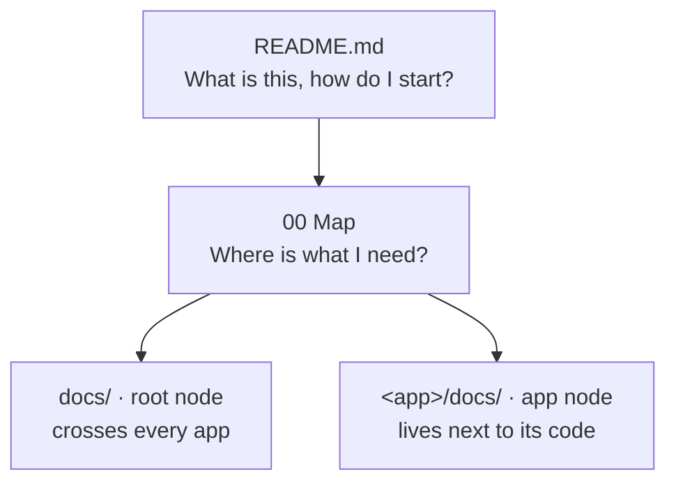

# How the docs work

Read this page to write, place and maintain a document in the AAD-docs standard.



## Where a document goes

| Document | Answers | Lives in | Tone |
|---|---|---|---|
| `README.md` | What is this and how do I start in five minutes? | Repository root | Practical, direct |
| `00-map.md` | Where do I find what I need? | Root node | Index, no prose |
| `01-overview.md` | What is it for, and what does it not do? | App node | Explanatory, brief |
| `02-getting-started.md` | How do I get it running? | Root node | Imperative, copyable commands |
| `03-architecture.md` | How is it built? | Root node | Technical, with diagrams |
| `04-read-the-code.md` | Where do I start reading the code? | App node | Entry points only |
| `05-guides/` | How do I do task X? | App node | Step by step |
| `06-reference/` | What are the exact parameters? | App node | Tables, exhaustive |
| `07-decisions/` | Why was it done this way? | App node | Context, alternatives, consequences |
| `08-operations.md` | How do I keep it running? | Root node | Checklists, runbooks |

The minimum for a project is three files: `README.md`, `00-map.md` and `02-getting-started.md`. Add the rest when its absence hurts.

## Anatomy of a page

Every page opens the same way and closes the same way, so nobody has to explain how to read it.

| Part | Content | Required on |
|---|---|---|
| 1 · Purpose | One line: what you get from reading the page | Every page |
| 2 · Diagram | The whole idea before any text | Every page |
| 3 · Before you start | What you need to have or know, with links | Pages where the reader does something |
| 4 · Steps | Numbered, each with a copyable command or a screenshot | Pages where the reader does something |
| 5 · Result | How you know it worked | Pages where the reader does something |
| 6 · Next | Where to go after, and where to go if it failed | Every page |

## File types

The app reads five extensions: `.md`, `.mdx`, `.yml`, `.csv` and `.json`. What each one holds, who writes it and how it is shown is in [file-types.csv](../aad_docs/docs/06-reference/file-types.csv).

- Write pages as `.md`. The `.yml`, `.csv` and `.json` files are data that the app draws as interactive views.
- Use `.mdx` only when a page needs a table, a flow, a model or a visual component, such as a callout, steps, tabs or cards, inside its text. An `.mdx` is Markdown plus a closed list of tags, listed in [mdx-tags.csv](../aad_docs/docs/06-reference/mdx-tags.csv). GitHub shows an `.mdx` as plain text, so a page that must read well there stays `.md`.
- Screenshots are the only other file allowed. They live in `<app>/docs/assets/` and are only linked from a `.md`.

## Write for the reader

A document written during a conversation tends to answer the person who asked for it. Its reader was not in that conversation, and a page that replies to a request leaves that reader without the problem, the context or the reason.

- Before you write, name the reader: who reads the page, what they already know and what they need to do.
- Do not answer a request inside the document. If a sentence only makes sense to someone who knows who asked for it or why, rewrite it.
- Present each rule with the problem it solves and one example. Without them the reader cannot tell why the rule exists or when it applies.
- A title names the subject the way the reader would look for it, not the words of the request.

| Document | Who reads it | What they already know |
|---|---|---|
| README | Anyone who arrives at the project | Nothing about the project |
| `01-overview` and guides in Spanish | The person who uses the system | The business, not the code |
| `02-getting-started`, `08-operations` | The person who installs or maintains the project | Django and the terminal |
| `03-architecture`, `04-read-the-code`, `06-reference` | The person who will change the code | Django, not this project |
| `07-decisions` | The person who picks the project up months later | The code as it is today, not its history |
| `HOW-DOCS-WORK` | The person who will write documentation | The project, not the standard |

## Tone

- Second person, imperative: "Run…", "Set…".
- What and why first, how after.
- Commands are always copyable, never described in prose.
- An explanation longer than two paragraphs belongs in architecture or in a decision, not in the README.
- Define a technical term the first time it appears.

## Visual standard

- Diagrams are Mermaid inside the Markdown. GitHub draws them, and they are reviewed in the same pull request as the code.
- One diagram, one idea. If it does not read at a glance, split it.
- Names in a diagram are the real names in the code.
- Model and route diagrams are generated from the code. Only architecture and flow diagrams are drawn by hand.
- Color only with meaning: one accent for the entry point.
- A decision shows the state before and after it.
- Callouts, steps, tabs and cards are components of an `.mdx` page. The semantic tags `<details>` and `<summary>` work in `.md` too. Any other HTML shows as text and never runs. The list is in [mdx-tags.csv](../aad_docs/docs/06-reference/mdx-tags.csv).

## Languages

English is the default language: every page exists in it, and it is the fallback when a page has no variant for the active language. Other languages are added page by page ([0004](../aad_docs/docs/07-decisions/0004-default-language-english-others-added.md)). This repository adds Spanish as its example, for what a non-technical user reads.

| Document | English | Spanish |
|---|---|---|
| README | Full | Short: what it is and how to use it (`README.es.md`) |
| `01-overview` | Yes | Yes (`01-overview.es.md`) |
| A guide a non-technical user performs | Yes | Yes (`name.es.md`) |
| Everything else | Yes | No |

- A page in another language sits next to its English source with the language code as suffix: `name.es.md`, or `name.es.mdx` for an `.mdx`. Both are the same page.
- A page in another language is written for the person who reads it, not translated word by word. The Spanish pages here have no jargon, no commands and a screenshot on each step.
- A page in another language starts with a header that names its source and the date it was synced. `docs_check` reports it when the source changed after that date.

  ```yaml
  ---
  source: 01-overview.md
  synced: 2026-11-14
  ---
  ```

- Model names and help texts come out in Spanish from Django translations (`gettext_lazy`). Do not copy them into `docs/`.

## One owner per fact

Documentation goes stale in two ways. The same fact is written in two places, one is updated and the other keeps saying the old thing. Or a command regenerates a file and erases what a person had corrected by hand.

One rule prevents both: each fact has one owner. Every other place links to it or displays it, and never copies it.

Example: the `status` field of `Order` is explained in its `help_text`. No page describes it again. A page that needs to show it uses `<Model name="orders.Order" />` in an `.mdx`, or links to the model page, and the explanation changes when the field does.

| Fact | Owner | Not repeated in |
|---|---|---|
| Name, fields, types and relations of a model | Model metadata: `Meta`, field options | Any `.md`; any hand-written `.csv` |
| What a model, view or service is | Its docstring | `04-read-the-code.md` |
| Routes, views and classes that exist | The code, through `code-map.yml` | `04-read-the-code.md`, guides |
| What the app is for, when to use it | `01-overview.md` and the guides | `help_text`, docstrings |
| How to do a task | `05-guides/` | README, overview |
| Why it was designed this way | `07-decisions/` | Comments, docstrings, README |
| How to run the project | `02-getting-started.md` | README, which only links |
| Settings, node options, tags, file types, commands and checks | The Python registry that defines each one | Any hand-written table, once the registry exists |

- A file is generated or hand-written, never both.
- Commands write only generated files and never touch a `.md`.
- A command that finds a generated file edited by hand stops and reports it.
- If a `.md` and the model disagree, the model wins.

## Maintain

| Task | Do |
|---|---|
| Add a page | Create the file in the right folder; add it to `pages` in `__init__.py` if the node lists pages |
| Add a section | Create a subfolder with an `__init__.py` |
| Refresh the code map and reference tables | `python manage.py docs_codemap` |
| Retake screenshots | `python manage.py docs_screenshots` |
| Find stale, broken or repeated content | `python manage.py docs_check` |

## Status of this repository

One page here is an `.mdx`, as the example of that format: [embed-a-piece.mdx](../aad_docs/docs/05-guides/embed-a-piece.mdx).

Until the commands exist, the files here are written by hand as the design target. `code-map.yml` becomes generated at milestone 2 and the tables of `06-reference/` at milestone 3; the first run replaces each once. `request-flow.json` stays hand-written, because nothing extracts it. No screenshots exist yet; `docs_screenshots` takes them at milestone 4, and a person links them in the guide, because commands never write a `.md`.

## Next

- Which address a page gets: [03-architecture.md](03-architecture.md#addresses)
- Document one of your apps: [document-an-app.md](../aad_docs/docs/05-guides/document-an-app.md)
- Exact options of a node: [node-options.csv](../aad_docs/docs/06-reference/node-options.csv)

## Default document layout

Use the full available page width. On wide screens the default is three regions: documentation navigation, main content, and a local section outline. Keep the three regions in desktop IDE preview panels, with flexible sidebars; only stack below 42rem (672 CSS pixels at the default font size). Preserve the shared Design System tokens and readable, scrollable content.
