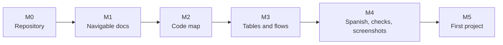

# Project plan

Read this page to see what AAD-docs will deliver, in what order, and how each milestone is accepted.

## Goal

Keep the documentation of every project current, navigable and consistent, so that the owner can move through a complex project as a user would.

| Requirement | How the project meets it |
|---|---|
| Navigate a project without reading all its code | Code map generated from models, routes and classes |
| Very visual | Every page opens with a diagram; data files become interactive views |
| English for technical readers, Spanish for non-technical users | `name.es.md` next to `name.md`; Django translations for model texts |
| Screenshots and interactive pieces | `docs_screenshots`; explorer, table and simulator drawn from data files |
| Flat files | `.md`, `.yml`, `.csv`, `.json` inside each app's `docs/` |
| Explains itself | Fixed page anatomy; `HOW-DOCS-WORK.md` |
| Installable Django app | `aad_docs` in `INSTALLED_APPS`; `__init__.py` resolves each node |
| Model metadata resolves model documentation | `docs_codemap` reads `_meta`, field options and docstrings |
| No overwriting, no repetition | One owner per fact; generated-file manifest; `docs_check` |

## Out of scope

- Editing documentation in the browser. Files are edited in the editor and reviewed in git.
- A database. The app defines no models.
- Hosting a public documentation site.
- Documenting code that is not a Django app.

## Milestones

Each milestone advances backend and frontend together and ends with something usable. The documentation of AAD-docs is the acceptance test: each milestone must render more of it.

### M0 · Repository

| Deliverable | Detail |
|---|---|
| Package skeleton | `pyproject.toml`, `aad_docs/__init__.py`, `apps.py`, package data for `docs/`, templates and static files |
| Demo project | `demo/` with settings, `urls.py` and one small app, `demo/catalog`, that has a model |
| CI | Tests and lint on every pull request |

Accepted when: `pip install -e .` works and `python demo/manage.py check` passes.

The demo app exists because `aad_docs` has no models. It is the only place where the model-metadata features can be shown and tested.

### M1 · Navigable docs

| Side | Deliverable |
|---|---|
| Backend | Discovery, nodes, `.md` reader, URLs and views, staff-only access |
| Frontend | Base layout, navigation menu, page with Mermaid |

Accepted when:

- `/docs/aad-docs/` and `/docs/project/` in the demo render every `.md` in this repository, diagrams included.
- An empty `__init__.py` produces a node with default slug, title and page order.
- A folder without `__init__.py` does not appear.
- A non-staff user gets no access.

### M2 · Code map

| Side | Deliverable |
|---|---|
| Backend | `docs_codemap`: models from `_meta`, routes from the URL resolver, classes and docstrings; `.yml` reader; generated-file manifest |
| Frontend | Explorer: route, view, service, model, each with its file |

Accepted when:

- `docs_codemap` writes `aad_docs/docs/code-map.yml`, replacing the hand-written design target, and `demo/catalog/docs/code-map.yml` with the demo model.
- The model diagram of `demo/catalog` is drawn from its relations.
- Editing a generated file by hand makes the next run stop and report it.
- `docs_codemap --check` fails when the code changed and the files did not.

### M3 · Tables and flows

| Side | Deliverable |
|---|---|
| Backend | `.csv` and `.json` readers; reference tables generated from model metadata, settings defaults and command help |
| Frontend | Table that sorts and filters; simulator for `"type": "flow"` |

Accepted when:

- Every file in `aad_docs/docs/06-reference/` opens as a sortable, filterable table.
- `request-flow.json` plays step by step.
- The field table of the demo model is generated, with `help_text` as its description.

### M4 · Spanish, checks, screenshots

| Side | Deliverable |
|---|---|
| Backend | Language selection with fallback; `docs_check`; `docs_screenshots` |
| Frontend | Language switcher; screenshots in guides |

Accepted when:

- With Spanish active, `01-overview` and `browse-the-docs` show their `.es.md`; every other page falls back to English.
- Model names and help texts of the demo app show in Spanish from its translations.
- `docs_check` reports each rule in [checks.csv](../aad_docs/docs/06-reference/checks.csv) on a fixture built to break it, and passes on this repository.
- `docs_screenshots` takes the screenshots of `browse-the-docs` in both languages.

### M5 · First project

Install the app in one real project, document one of its apps to the minimum (README, map, getting started, overview, generated code map) and record what the standard got wrong.

Accepted when: the owner can find a model, a route and a class of that app from `/docs/` without opening the code.

The project is not chosen yet.

## Risks

| Risk | Effect | Response |
|---|---|---|
| Importing `__init__.py` runs arbitrary code at startup | A broken node breaks the docs, or the project | Import inside a guard; a failing node is reported by `docs_check` and skipped, never fatal |
| Docs expose internal structure | Models and routes visible to the wrong reader | Staff-only by default; `ACCESS` setting |
| Class discovery is fuzzy | The code map lists noise or misses services | Start with models, views and URL patterns, which Django can enumerate; add other classes by convention (`services/`) and by opt-in |
| Spanish falls behind | Users read outdated pages | `synced` header checked by `docs_check` in CI |
| Generated files drift from code | The map lies | `docs_codemap --check` in CI |
| Docs missing from installed packages | Empty nodes in production | Package data declared at M0; a check at startup |

## Open decisions

| Decision | Proposed | Recorded in |
|---|---|---|
| Frontend technology | Django templates and plain JavaScript in the package | [0007](../aad_docs/docs/07-decisions/0007-frontend-django-templates.md) |
| Package name, versions, libraries | `aad_docs`; Python 3.11+, Django 4.2+; `markdown-it-py`, `PyYAML`; Mermaid vendored | [0008](../aad_docs/docs/07-decisions/0008-package-name-and-dependencies.md) |
| First project for M5 | Not chosen | This page |
| Screenshot tool | Playwright against the local server | Decide at M4 |

## Next

- How the pieces fit: [03-architecture.md](03-architecture.md)
- Where each piece will live: [04-code-map.md](../aad_docs/docs/04-code-map.md)
