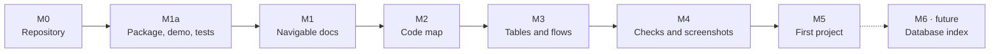

# Project plan

Read this page to see what AAD-docs will deliver, in what order, and how each milestone is accepted.

## Goal

Keep the documentation of every project current, navigable and consistent, so that the owner can move through a complex project as a user would.

| Requirement | How the project meets it |
|---|---|
| Navigate a project without reading all its code | Code map generated from models, routes and classes |
| Very visual | Every page opens with a diagram; data files become interactive views |
| English as the default language, other languages added per page (Spanish here, for non-technical users) | `name.es.md` next to `name.md`; Django translations for model texts |
| Elements that become visual components | Closed registry of components, rendered by Django templates ([0013](../aad_docs/docs/07-decisions/0013-visual-components.md)) |
| Screenshots and interactive pieces | `docs_screenshots`; explorer, table and simulator drawn from data files; `.mdx` pages that embed them |
| Flat files | `.md`, `.mdx`, `.yml`, `.csv`, `.json` inside each app's `docs/` |
| A fixed address for every app, page and model on the live site | Addresses taken from app and model metadata; `docs_url()` |
| Explains itself | Fixed page anatomy; `HOW-DOCS-WORK.md` |
| Installable Django app | `aad_docs` in `INSTALLED_APPS`; `__init__.py` resolves each node |
| Model metadata resolves model documentation | `docs_codemap` reads `_meta`, field options and docstrings |
| No overwriting, no repetition | One owner per fact; generated-file manifest; `docs_check` |

## Out of scope

- Editing documentation in the browser. Files are edited in the editor and reviewed in git.
- A database in the core. The app defines no models through M5. A later delivery adds an optional index: see M6.
- Hosting a public documentation site.
- Documenting code that is not a Django app.

## Roadmap

What the owner can do at the end of each milestone, and what each one waits for.

| Milestone | After it, the owner can | Status | Waits for |
|---|---|---|---|
| M0 · Repository | Read the complete design as documentation | Done | — |
| M1a · Package, demo, tests | Install the app and run the demo | Next | The owner's go-ahead to start code |
| M1 · Navigable docs | Browse every page of this repository at `/docs/`, in English and Spanish | Planned | M1a |
| M2 · Code map | Find a model, a route or a class from the browser | Planned | M1 |
| M3 · Tables and flows | Sort tables, play flows and use callouts, steps, tabs and cards | Planned | M2 |
| M4 · Checks and screenshots | Trust the docs in CI and see the screens | Planned | M3 |
| M5 · First project | Use it on a real app | Planned | M4 and the choice of the project |
| M6 · Database index | Search all pages and link a page to a model | Future | M5 |

Decisions 0007, 0008, 0010 to 0013 and 0015 are still proposed; 0014 is accepted, and 0009 is a recommendation for M6. Each proposed decision is confirmed or changed before the milestone that builds it starts: 0007, 0008 and 0015 before M1a, 0010 before M1, 0011, 0012 and 0013 before M3.

## Milestones

Each milestone advances backend and frontend together and ends with something usable. The documentation of AAD-docs is the acceptance test: each milestone must render more of it.

### M0 · Repository

Done. The project's documentation, written as the design target: README, plan, architecture, the app node `aad_docs/docs/` and the decisions.

Accepted when: every page opens with a purpose line and a diagram, and every link resolves.

### M1a · Package, demo and tests

| Side | Deliverable |
|---|---|
| Backend | `pyproject.toml` with the dependencies, including pinned `django-dsadmin`, the `[dev]` extra (`pytest`, `pytest-django`), the `[screenshots]` extra (Playwright) and package data for `aad_docs/docs/**`, templates and static files, including vendored Mermaid and the pinned design-system CSS with their provenance ([0014](../aad_docs/docs/07-decisions/0014-reuse-from-the-owners-repositories.md)) |
| Backend | `aad_docs/__init__.py` exports `Node`, pure Python, and `docs_url`, which loads the routing on its first call |
| Backend | `conf.py`: `DEFAULTS` and `get_settings()`, which merges `settings.AAD_DOCS` over them |
| Backend | `apps.py` registers the system checks, such as the presence of the packaged `docs/` |
| Demo | `demo/` with `USE_I18N`, `LocaleMiddleware`, `LANGUAGES` in English and Spanish, `AAD_DOCS["ROOT"]` pointing at this repository's `docs/`, and the `i18n/` and `docs/` URLs |
| Demo | `demo/catalog`: models with `verbose_name`, `help_text`, relations and translations |
| CI | Tests, lint and `tools/check.sh` on every pull request |

Accepted when:

- `pip install -e ".[dev]"` works and `python demo/manage.py check` passes.
- A smoke test of `AadDocsConfig` and `get_settings()` passes in `pytest`.
- `from aad_docs import Node` works before Django is set up.

The demo app exists because `aad_docs` has no models. It is the only place where the model-metadata features can be shown and tested.

### M1 · Navigable docs

| Side | Deliverable |
|---|---|
| Backend | Discovery that loads each `__init__.py` by path under a unique module name; nodes with the semantics of `pages` and `visible`; sibling order by `order` and `slug`; language variants grouped under one page |
| Backend | `.md` reader: header removed, semantic tags read and any other HTML shown as text, first heading as title; active-language selection with fallback |
| Backend | Routing, `docs_url()`, views and the staff-only access mixin; the asset view with a closed list of image types |
| Frontend | Base layout, navigation menu, breadcrumbs, language switcher, page with Mermaid in strict mode |

Accepted when:

- `/docs/aad-docs/` and `/docs/project/` in the demo render every `.md` in this repository, diagrams included, with no header visible.
- With Spanish active, `01-overview` and `browse-the-docs` show their `.es.md`; every other page falls back to English; no `.es.md` is listed as a page of its own.
- An empty `__init__.py` produces a node with default slug, title and page order.
- A folder without `__init__.py` does not appear, and an `__init__.py` that raises is skipped without breaking the rest.
- Each page answers at the address its file name gives it, and `docs_url("aad_docs")` returns `/docs/aad-docs/`. `read-the-code` and `code-map` answer at different addresses.
- A path that leaves the node folder, and an asset of a type outside the list, answer 404.
- A section and a model with the same slug resolve to the section.
- A non-staff user gets no access.

### M2 · Code map

| Side | Deliverable |
|---|---|
| Backend | `docs_codemap`: models from `_meta`, routes from the URL resolver, classes and docstrings; `.yml` reader; generated-file manifest with its initial design-target set; model pages and their addresses |
| Frontend | Explorer: route, view, service, model, each with its file |

Accepted when:

- `docs_codemap` writes `aad_docs/docs/code-map.yml`, replacing the hand-written design target once and recording its hash, and `demo/catalog/docs/code-map.yml` with the demo model. `request-flow.json` is never touched.
- The model diagram of `demo/catalog` is drawn from its relations.
- Each model of `demo/catalog` has a page at `/docs/catalog/<model-slug>/` with no file written, and `docs_url(Model)` returns that address.
- A file in `demo/catalog/docs/<model-slug>/` shows under the address of that model.
- Model names and help texts of the demo app show in Spanish from its translations.
- Editing a generated file by hand makes the next run stop and report it.
- `docs_codemap --check` fails when the code changed and the files did not.

### M3 · Tables and flows

| Side | Deliverable |
|---|---|
| Backend | `.csv`, `.json` and `.mdx` readers; the closed tag registry with its visual components (callout, steps, tabs, cards, and the semantic tags `details` and `summary`, which the `.md` reader also reads); each table of `06-reference/` generated from its owner in Python ([0012](../aad_docs/docs/07-decisions/0012-reference-tables-from-their-owner.md)); the field table of a model |
| Frontend | Table that sorts and filters; simulator for `"type": "flow"`; pieces mounted inside an `.mdx` page; one template for each component and `tabs.js`; each page loads only the scripts its components need |

Accepted when:

- Every file in `aad_docs/docs/06-reference/` opens as a sortable, filterable table, is generated, and no longer carries the `milestone` column.
- `request-flow.json` plays step by step.
- `embed-a-piece.mdx` shows its table and its flow inside the page, and the tags in its code blocks stay as text.
- A tag with a `src` that leaves the node folder is an error.
- A page with a callout, steps, tabs and cards renders each as a design-system component; an unclosed container is reported (D063).
- A `
` in a `.md` page opens and closes. A `<script>` shows as text and never runs, and is reported as D065.
- The field table of the demo model is generated, with `help_text` as its description.

### M4 · Checks and screenshots

| Side | Deliverable |
|---|---|
| Backend | `docs_check` with the criteria of [checks.csv](../aad_docs/docs/06-reference/checks.csv); `checks.csv` generated from `CHECKS`; `docs_screenshots` |
| Frontend | Screenshots in guides |

Close it in this order, because commands never write a `.md`:

1. Run `docs_screenshots` to take the screenshots of `browse-the-docs`, in English and in Spanish.
2. Link them by hand in `browse-the-docs.md` and `browse-the-docs.es.md`.
3. Run `docs_check` on this repository.

Accepted when:

- `docs_check` reports each rule of checks.csv on a fixture built to break it, and passes on this repository.
- `docs_screenshots` writes the screenshots of `browse-the-docs` in both languages.

### M5 · First project

Install the app in one real project, document one of its apps to the minimum (README, map, getting started, overview, generated code map) and record what the standard got wrong.

Accepted when: the owner can find a model, a route and a class of that app from `/docs/` without opening the code.

The project is not chosen yet. `kv` is the candidate: it runs Django 5.2, has its own documentation conventions and a layered frontend, so it shows where the standard fits and where it does not ([0014](../aad_docs/docs/07-decisions/0014-reuse-from-the-owners-repositories.md)).

### M6 · Database index (future delivery)

Recommended, not scheduled. Start it after M5, once a real project shows which of its gains are needed.

Combine the file-based documentation with [django-tree-queries](https://github.com/feincms/django-tree-queries) in an optional module, `aad_docs.index`. The files stay the source; the index is derived from them and rebuilt by a command. The reasons and the alternatives are in [decision 0009](../aad_docs/docs/07-decisions/0009-optional-database-index.md).

| Side | Deliverable |
|---|---|
| Backend | `DocNode` model on django-tree-queries; `docs_sync` and `docs_sync --check`; search; link from a node to a model; permissions per node |
| Frontend | Search box and results with their path in the tree; help link in the admin of a linked model |

Build order: search first, then the link between nodes and models, then permissions.

Accepted when:

- The core still works, with no model and no migration, in a project that does not install the module.
- Deleting every row and running `docs_sync` restores the same index.
- A search for a word in any page returns that page with its path in the tree.
- The admin of a linked model opens its documentation page.

## Risks

| Risk | Effect | Response |
|---|---|---|
| Importing `__init__.py` runs arbitrary code at startup | A broken node breaks the docs, or the project | Import inside a guard; a failing node is reported by `docs_check` and skipped, never fatal |
| The package imports Django code before Django is ready | `AppRegistryNotReady` in every node file | `aad_docs/__init__.py` imports only pure-Python `Node`; `docs_url` loads the routing on first call |
| A root `docs/` package collides with another package named `docs` | The wrong module is loaded | Every `__init__.py` is loaded by path under a unique module name |
| Raw HTML or SVG in documentation opened with `ACCESS = "public"` | A script runs in a reader's browser | Raw HTML never rendered, SVG not served, Mermaid in strict mode, scripts only from static files |
| A reference table and its owner in code disagree | The table lies | Tables are generated from the owner; `docs_codemap --check` in CI |
| Docs expose internal structure | Models and routes visible to the wrong reader | Staff-only by default; `ACCESS` setting |
| Class discovery is fuzzy | The code map lists noise or misses services | Start with models, views and URL patterns, which Django can enumerate; add other classes by convention (`services/`) and by opt-in |
| A translation falls behind | Readers see outdated pages | `synced` header checked by `docs_check` in CI |
| Generated files drift from code | The map lies | `docs_codemap --check` in CI |
| The database index falls behind the files (M6) | Search and links show outdated content | The index is never edited by hand; `docs_sync --check` in CI |
| Docs missing from installed packages | Empty nodes in production | Package data declared at M1a; a system check at startup |

## Open decisions

| Decision | Proposed | Recorded in |
|---|---|---|
| Frontend technology | Django templates and plain JavaScript in the package | [0007](../aad_docs/docs/07-decisions/0007-frontend-django-templates.md) |
| Package name, versions, libraries | `aad_docs`; Python 3.11+, Django 5.2+; `markdown-it-py`, `PyYAML`; Mermaid and the design-system CSS vendored | [0008](../aad_docs/docs/07-decisions/0008-package-name-and-dependencies.md) |
| First project for M5 | Not chosen | This page |
| Addresses | Taken from app and model metadata; model slug is `model_name` | [0010](../aad_docs/docs/07-decisions/0010-addresses-from-metadata.md) |
| `.mdx` | Markdown plus a closed list of tags; no JavaScript, no build | [0011](../aad_docs/docs/07-decisions/0011-mdx-closed-tag-set.md) |
| Database index | Optional module on django-tree-queries, in a future delivery | [0009](../aad_docs/docs/07-decisions/0009-optional-database-index.md) |
| Screenshot tool and test runner | Playwright in the `[screenshots]` extra; `pytest` and `pytest-django` in `[dev]` | [0008](../aad_docs/docs/07-decisions/0008-package-name-and-dependencies.md) |
| Visual components and raw HTML | Closed registry, Django templates; raw HTML never rendered; each component declares if it needs JavaScript | [0013](../aad_docs/docs/07-decisions/0013-visual-components.md) |
| Reference tables | Generated from their owner in Python | [0012](../aad_docs/docs/07-decisions/0012-reference-tables-from-their-owner.md) |
| Agent tooling | Dependencies and executables pinned and kept in the repository; the Mermaid check is mandatory | [0015](../aad_docs/docs/07-decisions/0015-the-repository-carries-its-agent-tooling.md) |

## Next

- How the pieces fit: [03-architecture.md](03-architecture.md)
- Where each piece will live: [04-read-the-code.md](../aad_docs/docs/04-read-the-code.md)
